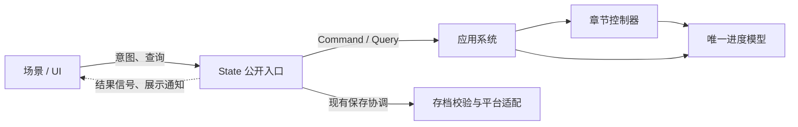

# 7:55 架构与开发规范

基线为 `main` 的 `14e86ac5`（2026-11-06）。本文记录已核对的边界，并给出后续改动的审查规则。章节玩法、输入、UI 和提交范围仍遵循 [AGENTS.md](../AGENTS.md)。

## 架构判断

7:55 目前需要收拢的是**谁有权改变游戏状态、何时保存、其他系统何时可以观察到变化**。QFramework 已经为常规章节动作和导航提供入口。原生状态集中在一个模型中，现有兼容接口仍允许多个调用方写入。下一步按玩家操作逐段迁移写入者，优先处理会影响章节交接、刷新恢复或道具消耗的路径。

| 边界 | 职责 | 入口 |
| --- | --- | --- |
| 正式游戏 | Godot 4.7.1，桌面和生产 Web 共用原生控制器。浏览器通过同版模板导出，浏览器专属能力由平台适配层提供。 | [Godot 工程](../godot_native/README.md) · [Web 构建与发布](../godot_native/docs/GODOT_WEB_RELEASE.md) |
| 保留的 Web 实现 | React/Phaser 可以独立构建，提供原有行为回归与源模型差分。它有自己的控制器和 `SaveStore`，生产 Godot 运行时不调用它。 | [测试策略](TESTING.md) |
| 共创平台 | 独立构建、部署和管理业务数据。共用玩家账号已有设计；接入通过约定的服务接口，平台的数据和游戏剧情存档各自有所有者。 | [平台架构](../platform/docs/architecture.md) · [共用玩家账号](../platform/docs/shared-player-account.md) |
| 实验与独立交付物 | 用各自的预览、样例或作者工程验证。进入正式游戏需要明确接入范围、资源打包和普通入口的验收；样例能运行只证明样例自身。 | [生产内容范围](../godot_native/docs/GODOT_WEB_RELEASE.md) |

## 正式游戏的依赖方向

当前由 `State` 创建 `GameArchitecture` 并注册模型、系统和工具。常规动作经 `State.act()` 进入 `StoryActionCommand`，由 `ChapterSystem` 分发至章节控制器，`State._accept_result()` 仍处理结果、保存和信号。读模型可用 `State.read_snapshot()` 或现有窄查询。同步返回与信号顺序属于现有调用约定；上游框架固定版本和同步适配见 [QFramework 迁移记录](../godot_native/docs/QFRAMEWORK_ARCHITECTURE.md)。

### 改动必须遵守的边界

1. **场景上报意图，控制器判定结果。** 点击、拖拽、滚动、碰撞和动画完成可以提供操作或证据，章节控制器决定门槛、奖励、消耗和正式交接。新增或迁移的路径通过命名明确的动作和结果表达字段、失败原因及重复触发语义。系统和模型不反向获取 UI 节点。
2. **状态按生命周期归属。** 章节事实、道具和安全检查点进入验证过的共享状态；拖拽、输入时钟、动画、临时选择和失败提示留在会话或场景。会影响剧情的阅读结果属于控制器，当前滚动像素属于 UI。新代码通过查询读取脱离共享模型的数据；禁止新增视图对 `State.d` 的直接或别名写入，也不把可写字典塞进新的信号、查询或回调。
3. **应用层协调跨边界的顺序。** 接受、拒绝、重复动作、离场取消和保存失败都要有可解释的结果。道具扣除与奖励发放由同一控制器操作处理。迁移现有同步路径时，保留经验证的保存与通知顺序；需要异步 I/O 的能力用独立接口，并显式定义完成、失败、取消和过期结果。云端保存或浏览器持久化的成功须用对应回执或实际恢复证明。
4. **共享内容从作者源生成。** 修改共享物品、剧情或其他同步数据前先确认作者源。对 `sync_source.mjs` 管理的文件，修改源并重新生成，保留生成差异和两端受影响的验证。原生独有内容仍归原生工程。存档字段、道具 ID 和检查点是兼容契约，改动须定义旧值迁移、恢复结果和失败处理。见 [同步工具](../godot_native/tools/sync_source.mjs) 与 [存档兼容规范](../godot_native/docs/SAVE_COMPATIBILITY.md)。
5. **依赖向内，发布与验证分层。** 正式代码不得依赖样例、开发跳转或归档运行时。原生引擎及模板随项目版本固定。涉及共享边界的提案先记录原因、调用方、状态所有者、兼容和验证，再决定是否改代码；不因框架分层引入无实际用途的系统或事件。

## 已知边界与迁移顺序

| 顺序 | 基线证据 | 建议验收 |
| --- | --- | --- |
| 1. 先收口一次交互的状态写入和顺序 | `State.d` 仍是可写兼容别名。手机与世界往返直接设置 `runtimeMode`，世界的位置同步直接写 `native.player` 和 `positions`。图书馆读完规则后，现行流程须先离开书页再提交阅读动作，否则新叙事的输入锁会拦住离页。 | 首个迁移试点建议选图书馆读完与离开这条完整链路。覆盖未读时拦截退出、读完后离页、叙事触发、刷新恢复、取消及重复关闭。确立做法后再逐条收口手机与世界切换、检查点写入。 |
| 2. 明确动作结果和保存边界 | `_accept_result()` 同时处理页面与场景更新、临时活动、存档及展示事件。部分世界会话仍绕过普通命令入口，经兼容桥直接调用旧控制器。 | 有第一条实测链路后再提取应用协调能力；先明确不同动作现有的保存、反馈和恢复语义，避免统一接口时改变行为。 |
| 3. 按改动热点缩小宿主职责 | `main.gd` 和 `world.gd` 同时连接路由、输入、物件与展示，现有命令覆盖部分行为。 | 随功能改动提取一个能独立描述生命周期的交互，证明入口、取消、退场和返回。仅移动脚本或给旧接口改名不能作为迁移验收。 |

对应源码：[状态入口](../godot_native/scripts/state.gd) · [章节系统](../godot_native/scripts/architecture/systems/chapter_system.gd) · [场景宿主](../godot_native/scripts/main.gd) · [世界宿主](../godot_native/scripts/world.gd) · [图书馆阅读器](../godot_native/scripts/ui/library_world_document.gd)。

### 原生世界的步行与存档

- 世界场景提供当前碰撞、可视范围、物件和门的状态。[步行几何](../godot_native/scripts/space/world_foot_navigation.gd)统一处理整脚扫掠、道路规划和校园墙缘滑移。图书馆书架、闸机、剧场门和北教动态障碍从同一批碰撞记录供给站立和寻路检查。食堂的独立场景继续提供自己的精确几何与寻路障碍。
- [步行请求](../godot_native/scripts/space/world_walk_route.gd)保存临时路点、反馈和等待抵达的交互。走过的每段路径按当帧几何重新验证。交互目标或章节状态失效时取消请求。世界把抵达动作交给原章节控制器。
- [状态入口](../godot_native/scripts/state.gd)和[进度模型](../godot_native/scripts/architecture/models/progression_model.gd)负责记录位置与手机、地图的选择。世界场景负责镜头、坐标和焦点，保留原有存档键、定时保存和显式返回的顺序。

## PR 审查与验收

涉及架构边界的 PR 用一条玩家路径交代改动前后行为，并回答：谁发出动作，谁有权接受它，写入哪些持久化字段，什么时候能确认写入，失败或取消后回到哪里。标明旧入口是否仍有调用者、迁移旧数据时如何恢复，以及哪些约束由现有检查覆盖、哪些仍需人工审查。

| 改动范围 | 验收证据 |
| --- | --- |
| 命令、查询、控制器、存档 | QFramework 行为比较与受影响章节专项。写路径覆盖拒绝、重入及恢复；读路径检查无副作用和快照隔离。迁移存档时使用实际旧文件并验证加载、继续和再次保存。 |
| 正式场景、输入、媒体或资源加载 | 原生专项和受影响的真实 Godot Web 导出路径。交互从普通入口开始，走完进入、操作、取消或失败、返回；触摸测试与实体设备验证分别记录。 |
| 共享源内容、状态契约 | 记录生成差异，运行受影响的保留 Web 回归和 Godot 源模型差分，再按影响范围补正式运行验证。 |
| 共创平台及跨产品接口 | 按平台规范验证。修改持久化时运行可丢弃 PostgreSQL 集成测试；涉及两个产品或共享 CI 路由时验证相应两侧及产品范围。 |
| 纯文档 | 核对源码引用、文档链接、差异与上位规范。 |

记录测试提交、环境、实际执行的路径和剩余差距。候选验证、GitHub 合并、正式发布和玩家验收各自留证。现有检查入口见 [参与开发](../CONTRIBUTING.md) 和 [Godot 验收与发布](../godot_native/docs/GODOT_WEB_RELEASE.md)。
