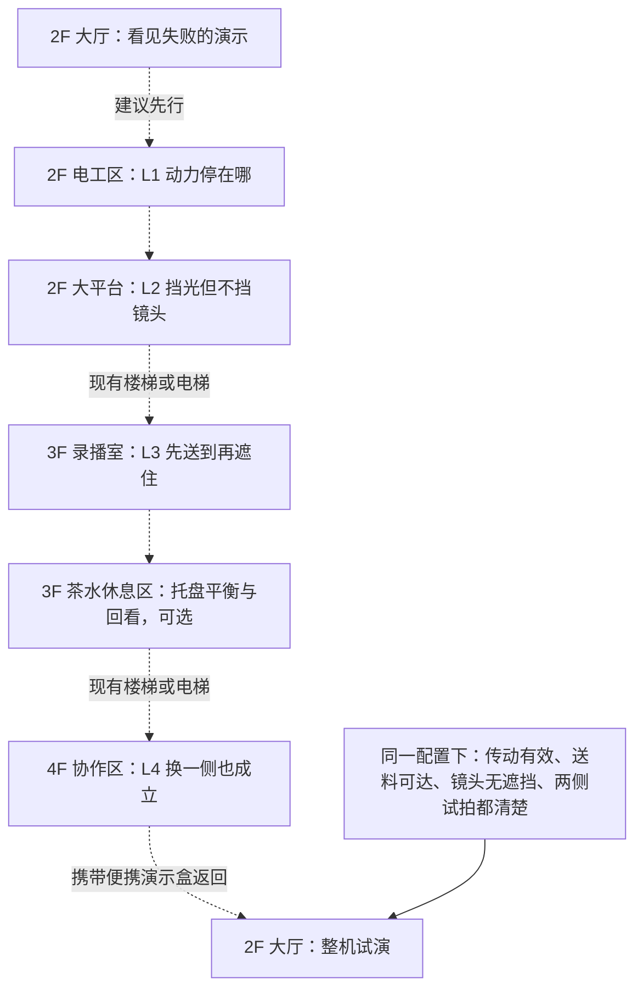

# 未来学习中心：全楼谜题设计与机制样本

2026-10-29 · 基于「解谜视频 · Qwen 本地转录」的玩法与关卡设计

2026-10-31 状态补充：主分支已接入 25 个可选探索房间及原有 29 个机制的持久存档，见[正式接入记录](../docs/FORMAL_INTEGRATION_20261030.md)。本页四关连贯叙事仍是设计稿；下文“独立试玩”描述的是早期样本。此次新增的工作室 2 双滑块与储物柜保留本会话状态，未扩展正式存档字段。

**长期设计准则：** 全部房间的主要操作须通过[可操纵的场景物件](../review/OBJECT_INTERACTION_20261029.md)完成，使用拖动、旋转、插拔、实体操纵杆和摇杆。禁止把核心操作放进屏幕按钮排或默认热键说明；提示与记录按需阅读。

**完整设计请先看[每一层、每一个房间的谜题设计](ROOM_PUZZLES_20261029.md)：二楼 8 间、三楼 10 间、四楼 7 间，25 间各有独立谜题。** 茶水区包含托盘平衡，储藏室包含柜内取用路径，四间工作室分别处理参照、连接、记录与装配顺序。全部房间清单、建议路线和逐间设计卡以该文档为准。

本页保留四个相连机制的详细样本：玩家在二楼把装置调通，在三楼发现“能拍清”与“能送到”会冲突，最后在四楼把临时解法改造成可复现的装置，再回二楼完成公开演示。统一操作是观察、移动、装配、试运行与撤回。四关样本与其有限状态验证不能代表全部 25 间的关卡验收。

本稿是可讨论、可验证逻辑的设计，尚未接入正式游戏。现有原生评审场景包含二楼传动操作台、[双屏同步小样](../review/SIGNAL_SYNC_20261029.md)、[太阳能竞赛与机器人往返](../review/MOTION_PUZZLES_20261029.md)，以及[三楼茶水区的慢速接水与托盘平衡](../review/PANTRY_WATER_20261030.md)、[三楼工作室 2 的双滑块窄口](../review/COUPLING_TRAY_20261030.md)，共六款独立试玩；移动白板遮光是独立浏览器设计原型。其余三四楼玩法、移动 NPC 与跨房间持久存档仍为新增提案。建筑实拍用于空间与对象参考，新增的演示盒、挡片、试验灯和角色台词属于游戏设计，不代表现场已有设备或真实人物活动。

[25 间的提示与难度曲线](GUIDANCE_AND_DIFFICULTY_20261029.md)区分基础操作、当前目标、现场反馈和逐层自选提示。[Argon 审阅包](ARGON_REVIEW_PACKET_20261029.md)已整理完整输入与逐间返回格式；尚待确认入口，没有外部审阅结论。

## 先看玩家会玩到什么

你走到二楼大厅，记录同学按下试拍，画面中的标记被亮斑淹没；旁边的送料装置又只响不走。你可以直接检查设备，也可以问同学刚才发生了什么。

在机电实验台上，你试着换一枚齿轮。之前只有电机转，现在后面也动了，但试件朝相反方向退。调整连接后，试件终于到达台面上的刻线。回到大厅，挪白板能消掉亮斑，却可能把镜头一起挡住；你得找到同时满足两个条件的摆法。

三楼录播室出现反例：挡片摆好时，静态画面很清楚，试件却送不进去。你先让通道打开，把试件送过，再把挡片复位。成功不是快按几个按钮，而是理解同一片板在不同阶段有不同作用。

四楼要把这个需要人来回挪板的方法改好。两次试拍分别从装置左右入光，装置须保持同一套布置，送料轨道和镜头也都要畅通。最终你用两片侧挡片留出前后开口，让一次布置同时满足四条路径。回到二楼，同学能照着这套装置完成演示，画面、传动和物件状态共同给出结果。

## 转录如何改变这版设计

本批来源共有 13 个视频、95 个分 P、约 75.49 小时。本轮核对全批目录与核验报告，并定向阅读设计相关片段，**没有观看全部录像，也没有逐字通读 95 篇稿件**。Qwen 稿含口误和识别错误，时间是音频分段范围，不能据此复原视频画面里的精确机关布局。P002 识别内容稀少，排除；另一合集的总标题与分 P 标题不一致，未用于推导双人玩法。

采用的来源片段、时间、原文行号、文件校验值和每项推导，见 [转录证据与设计取舍](TRANSCRIPT_EVIDENCE_20261029.md)。这里的装置布局与解法是新的设计，不是视频原关卡的复刻。

| 转录带来的启发 | 这次具体落地 |
| --- | --- |
| 《沉星之序》P062–063：可通关不等于构思成立，限制要服务于具体关系。[S01–02] | 每关写出可比较的两种解释，用装置反应排除一种；不按物件数计算推理步数。 |
| P065：干扰元素和藏起来的关键操作会掩盖问题。[S04] | 家具保持实拍密度；当前任务只有少量明确可操作的对象。沙发、柜子和花盆不全部变成解谜按钮。 |
| P066 与《nuworm》前三节：后关延展前关的操作语言。[S05、S07–09] | 从“连接动力”到“区分路径”，再到“路径的阶段冲突”和“同一配置满足多条件”。 |
| 《Trefolio》：通过操作结果比较规则。[S10] | 试运行留前后状态记录；便笺记录玩家实际看见的结果，不凭翻页自动补全规则。 |
| 《Carrot Kingdom》试玩者认为知识过早被撞出后，后续目标失去意义。[S06] | 后关增加新的约束组合；不靠读过某句话或试过若干次才解锁。已懂规则的人可以提前成功。 |
| P064 的鲁棒性讨论。[S03] | 检查越界、旧结果拼接、绕过送料等漏洞；允许满足全部物理条件的不同摆法。程序不能证明玩家是在推理还是猜中。 |

方法沿用项目的 [谜题发现契约](../../../docs/PUZZLE_DISCOVERY_20261024.md)，结合 `level-design` 的体验顺序、尺度与试玩工作流。既有北教剧情、电梯校准、楼梯谜题和控制器门槛不在本次改写范围。

## 四关机制样本的路线与节奏



虚线是建议体验顺序，实线是最终试演条件。楼层通行沿用已有楼梯、电梯及配对落点，不用谜题强行封门。L1–L3 提供学习机会，不是必须收集的盖章；玩家可在条件成立时直接解后关。最终通过依赖本次装置实际运行与同配置验证，不能把不同摆法的成功记录凑在一起。

| 节点 | 空间 / 已有对象锚点 | 玩家思考与节奏 | 目标时间 |
| --- | --- | --- | --- |
| 开场 | 2F `platform`，相机 `platform_camera_tripod_48` | 发现“装置没送到，画面也不清楚”两个可见问题 | 1 分钟 |
| L1 | 2F `electrical`，`electrical_assembly_bench` | 接通 → 比较转向；低压力教学 | 3–5 分钟 |
| L2 | 2F `platform`，白板 `platform_whiteboard_41`、研讨桌 `platform_discussion_table_38` | 挡光与挡镜头并非同一件事 | 4–6 分钟 |
| L3 | 3F `recording`，`recording_desk_234`、`recording_camera_tripod_233` | 正确的最终状态为什么不能从初态直接到达 | 3–5 分钟 |
| 茶水区 | 3F `pantry`，`pantry_pantry_island_250`、两张沙发 | 慢速接水并微调份量，结合杯位保持托盘平衡，再从大桌送到沙发 | 4–7 分钟，可选，待试玩校准 |
| L4 | 4F `collab_b`，`collab_b_desk_85`、`collab_b_whiteboard_137` | 从临时调节到同时满足多条件；高潮 | 6–9 分钟 |
| 收束与移动 | 回到 2F 平台 | 搬运便携盒、整机试演、结果回收 | 5–7 分钟 |

此表只描述四关样本和茶水区的局部节奏；全楼 25 间与八关建议路线的时长估算见[覆盖版](ROOM_PUZZLES_20261029.md)。实现时可先用 L1+L2 的 8–12 分钟切片观察玩家是否会利用反馈，再按逐间清单扩展；切片制作顺序不缩减设计覆盖范围。所有时长仍待真人试玩校准。

## 统一操作与反馈

步行仍由原生场景负责，点击物件先接近，再操作；近处 `Space` 与触摸操作等价，人物朝向不作为交互门槛。装置可拖拽，也可点选零件后点安装面；键盘能选零件、移动、旋转、试运行和撤回。只在装置操作模式中改变装置，退出后恢复步行。操作提示讲“怎么拿起、怎么试”，不讲“该装哪枚”。

每次试验按实际状态显示：动力在哪一段停止、标记怎样移动、亮斑是否消失、镜头看到了什么、送料是否碰到挡片。声效是同一结果的辅助表现；关闭声音、看不清颜色也能从运动、形状和短字幕判断。

一次拖动结束或一次装配算一个可撤回操作；拖动途中不刷撤回记录。试运行不消耗零件，失败不扣资源。取消、离开房间、失焦会停止未完成试验，不在后台继续发放成功。重摆只恢复当前装置，保留此前试验便笺和已完成的正式事实。

## L1：动力停在哪

**问题：** 电机在转，试件却没有到达刻线。沿用当前原生操作台的齿轮、皮带和张力，先把它作为短教学，不以试遍 36 个组合承担整章难度。

| 发现链 | 具体设计 |
| --- | --- |
| 线索 | 轴位和齿间空隙是实物证据；操作同学的旧试车条记录“有声音、输出轴没动”；记录同学的试件照片只留下位置变化。三个载体来自两名虚构角色，不给完整参数。 |
| 假设 | “电机没有动力”或“动力在连接处断开”。 |
| 实验 | 只换齿轮再试转，比较电机与从动轮；接上皮带后再比较两端转向。 |
| 反例 | 齿轮咬合后仍可能打滑；所有轮子在转也可能让试件后退。 |
| 应用 | 在台面另一端放一个返程刻线，要求同一传动原理把试件送回；该返程目标是新增教学提案，当前代码仅验证向右送料。 |

**作者参考解：** 当前向右试验对应中尺寸齿轮、交叉皮带、正常张力；返程练习换为开式皮带。此答案只供设计审阅，目标栏写“把试件送到刻线”，不列零件或参数。当前模型的张力语义保持教学抽象，不冒充真实设备的精确力学。

**通过：** 当前目标的实际试件触达刻线且完成本次试运行。调旋钮、翻试车条、听完 NPC 台词都不等于通过。返程新目标与现有 `workbench_model.gd` 的单一目标需以后分开实现和测试。

**失败反馈：** 空隙处轮子不跟转；咬死时接触处停止；打滑时轮动而皮带滑；反向时试件确实向回退。不会把正确子项逐个永久锁住。

**三层自选提示：** “比较哪两处在动。” → “只换一件，看看停止的位置变了没有。” → “对照试车条与试件照片的前后位置。” 提示不随失败次数自动升级。

## L2：挡光，但别挡住镜头

**问题：** 试件已经能到位，相机回放里的标记仍被亮斑遮住。大平台保持开放，使用现有移动白板，不在大厅增加一扇解谜门。

**可操作对象：** 一块白板、试拍开关、局部试验灯。相机、示范桌、标记是可检查对象。试验灯是新增教学设备；它不改变整栋楼的日夜进度。日照仍按原有方位/时间表现，不要求玩家等待真实下午。

| 发现链 | 具体设计 |
| --- | --- |
| 线索 | 记录同学留下的过曝试拍；操作同学在白板轮旁留下的摆位痕迹，只显示曾经移动；白板阴影与桌上标记的覆盖关系。 |
| 假设 | “必须把板放在相机正前方才能消亮斑”或“只需隔开来光与标记”。 |
| 实验 | 先移动白板，让标记落在阴影里，再检查镜头回放；可分别比较阴影和视线。 |
| 反例 | 白板挡住取景时，画面变暗却看不到标记，不能通过。 |
| 应用 | 切换另一侧试验灯，原来的位置失效；重新安排白板以拍清第二张。两张是学习记录，尚不构成 L4 的稳定配置证明。 |

**抽象示意：** 下图为桌面关系草图，不是建筑方位或实际地图坐标。

```text
                  标记 T ← 白板 B ← 试验灯甲
                    ↑
                  相机 C

挡住“灯 → 标记”，保留“相机 → 标记”。
灯换到左侧后，同样的关系仍需成立，但白板位置会变。
```

**作者参考解：** 来光一侧遮住整块标记，同时保留相机至标记的视线。连续摆位按有效区域验证，允许不同距离、角度；不要求踩中一个隐藏坐标。最小几何模型只枚举代表位置，原生实现仍须检验标记四角、挡板高度和镜头视锥。

**通过：** 本次回放同时满足不过曝、标记完整可见。反馈为过曝区域、挡住的实物或完整标记，不显示“白板 X 正确、Y 错误”的逐项答案。

**三层提示：** “暗下来不等于拍到了。” → “比较阴影里的标记和相机里的标记。” → “再看两张试拍：画面里多出的那块白色是什么？”

## L3：先送到，再遮住

**问题：** 三楼录播桌的挡片已能压住亮斑，静态试拍也清楚，但送料试件停在挡片前。这里把上一关的关系换成一个阶段问题。

使用现有桌子和相机，新增一套低速、带实体止挡的便携演示盒。盒内轨道与挡片由相同实物几何决定阻挡；不拿整间房的空气墙充当谜题。挡片能停在遮光位或侧旁停车位，两个位置都可直接看见并操作。

| 发现链 | 具体设计 |
| --- | --- |
| 线索 | 操作同学的送料试验条有碰停位置；记录同学的静态照片清楚；实际轨道延伸到被挡片占据的位置。 |
| 假设 | “传动又装错了”或“送料路线被挡片截住了”。 |
| 实验 | 齿轮连接不变，只移开挡片，再推进一段。 |
| 反例 | 永久移开挡片能送料，却再次过曝；只恢复上关的静态解又不能从起点送入。 |
| 应用 | 先让试件越过交叉处，到位后再恢复遮光；下一轮可主动退回试件、重现同一顺序。 |

```text
相机 C ─────→ 标记终点 T
                    ↑
                挡片遮光位 ── 侧旁停车位
                    ↑
                  送料起点
                    ↑
                  试验灯
```

**作者参考解：** 移到停车位 → 分段送料至终点 → 挡片回到遮光位 → 试拍。试件在实体止挡处稳定停住，玩家不需要抢一个短暂时间窗。送料期间可以停机，挡片不会夹碎物件。

**通过：** 此轮试件从起点沿合法轨道实际到达终点，随后本轮试拍清楚。只把试件拖到终点、只得到正确终态截图或回放旧影片均不构成送料证明。轨道上的试件只由送料机构移动，不开放与行为矛盾的自由拖拽。

**移动 NPC：** 记录同学在可达的侧面观察位与相机位之间走动，举相机、低头核对、示意试件停住。玩家可提前操作；NPC 找不到路时停在安全点并提示站位受阻，不能穿桌、越栏杆或把玩家夹住。拍摄判定来自设备状态，走路动画完成不是通关条件。

**三层提示：** “比较试件停的位置和板的位置。” → “保持传动不变，试一次暂时移开挡片。” → “把送料条与静态照片并排看：它们记录的是同一时刻吗？”

## 3F 茶水休息区：把托盘稳稳端起来

大桌上有一只会偏向较重一侧的练习托盘。玩家把四只不同重量的杯子安排到杯垫上，比较重量与离支点距离的共同作用，再从大桌送到沙发茶几。倾斜会让杯子滑回防滑边缘，停下后可重摆，不扣资源，也不考手速。完成条件是本次摆位保持平衡并实际到达茶几；只看杯子或听完对话不算完成。详见[茶水区完整设计卡](ROOM_PUZZLES_20261029.md#room-3-pantry)。托盘和杯垫是新增玩法道具，尚未接入原生场景。

沿用实拍的灰色地面、深灰长桌、两侧座椅、树、茶水柜、沙发和矮桌；新操作须留出桌边及茶几的接近与退出空间。这个 2–3 分钟的轻谜题可独立完成，也可跳过后再回来。完成后可坐下比较已有试拍和实际运转记录，未试出的结果不会预先出现在便笺上；不以茶水区完成状态锁住四楼。

## L4：换一侧，也要成立

**问题：** 现在每换一次来光方向，就要重新推大白板。协作区要把它变成别人能直接使用的便携装置。

新增两片可独立拆装的小挡片，安装在演示盒的可见边槽中。先以桌面试装模型验证，再按实拍风格生成透明对象；四楼桌椅、电脑、柜子位置不因解谜需要重排。装置局部的前/后/左/右与建筑东/西/南/北分开。

| 发现链 | 具体设计 |
| --- | --- |
| 线索 | 记录同学的左右来光对照试拍；操作同学的交接卡只写“测试之间未动装置”的复现条件；可见的镜头线与送料轨道。 |
| 假设 | “把目标围得越严越好”或“分别截住不需要的来光，留出需要的通路”。 |
| 实验 | 只装一片，先测试一侧，再保持配置切换另一侧；随后增加第二片比较。 |
| 反例 | 两片都在同侧不能处理另一侧；包住前口会挡镜头；包住后口会堵送料；分别改板取得的两张成功照片不证明同一配置有效。 |
| 应用 | 同一装配版本通过左右两侧试拍，且镜头、送料都畅通。完成后可选把夹具整体转 90° 做新方位练习；这不是正式完成的额外门槛。 |

```text
                    送料入口
                       ↓
试验灯乙 → 左挡片  [目标]  右挡片 ← 试验灯甲
                       ↑
                     相机
```

**作者参考解：** 两侧各一片，前后保持开放。按实际遮挡与通行条件接受解，不比较挡片 ID 或固定点击顺序。桌面离散模型有一个有效方位组合，连续空间实现应保留足够宽的合法区域及等价摆法。

**通过：** 同一 `configurationRevision` 与 `fixtureRevision` 下，实际送料及两个光照条件均完成；改装、挪机位或修改试验灯参数使待完成的验证失效。历史照片仍可回看，不能拿旧照片完成新装置。

**三层提示：** “是哪一条路径仍然不通？” → “只开一侧灯，试完后保持装置不动，再换另一侧。” → “对照交接卡、两张试拍和送料轨道，检查哪些条件必须同时成立。”

## 回二楼：整机试演与角色反馈

玩家将小型演示盒从桌面取下，携带到二楼指定示范桌；不是把整张操作台搬走。盒子的房间表现、近景表现和携带状态引用同一实例。传动部件、挡片和试件独立，不能用一张“完成状态图片”代替实际运行。

试演依次显示送料、甲侧试拍、乙侧试拍；每一步都由模型验证。失败停在该处并保留装配，玩家可修正再试。成功后，记录同学展示两张清楚的回放，操作同学实际运行一次装置，然后进入待编写的叙事交接。第一版不会凭此新增学分、主线物品、现有角色身世或正式章节入口。

| 提议角色（尚非既有人设） | 可见行动 | 语气 / 情绪范围 | 示例反馈，非答案 |
| --- | --- | --- | --- |
| 操作同学 | 侧身看轴、停机、示意碰停位置；步行使用同一地面与障碍数据 | 简短、平实；失败是疑惑，成功略放松 | “前面还在转，后面已经停了。” |
| 记录同学 | 走到相机侧位、试拍、并排核对回放 | 耐心、带比较意味；不替玩家推理 | “这张暗了，但标记也看不见了。” |
| 协作同学 | 在四楼保持摆法、切换两侧测试灯 | 清晰、审慎；完成后自然高兴 | “这次换一边试，先别动装置。” |

配音以后按“角色 + 关卡状态 + 反馈意图”分配声音和情绪。同一句失败反馈不叠加激烈警报；字幕先保证可懂，语音可关闭、打断或缺失。播完台词、动作结束、声调识别都不写入过关事实。这里没有生成或试听新配音。

## 空间、遮挡和相机约束

1. **楼层不重排。** 使用现有 2F/3F/4F 房间、门洞、环廊、东北/西南楼梯及电梯。二楼平台开放；三、四楼中庭是有玻璃边界的挑空，不允许踩入下层景物。所有上下楼从既有平层落点进入，沿现有楼梯过程完成，不能走到电梯顶或楼梯侧面来切层。
2. **同一物体有不同的几何用途。** 脚底碰撞、画面前后遮挡、装置送料阻挡、光照遮挡与镜头视线分别计算，都追溯同一物体变换。透明裁片不会自动成为实墙；能挡住阳光的板不能默认把镜头或整个房间也封住。相机裁剪不是边界围墙。
3. **尺度沿用实际代码。** 当前玩家参考帧 `96×128`、统一显示比例 `0.65`、脚底盒 `19.5×14.625`；当前楼层步速 `250` 世界像素/秒、操作台接近距离 `105`。它们来自共享指标/当前场景，不复制一份关卡专用常量。新增操作站至少检验完整脚底、转身、退出与 NPC 避让；一段新增通道以 4 倍脚底宽作为初稿舒适目标，最终仍由实际地图验证，不能改门洞来凑数。
4. **空间锚点已核对，精确新摆位待测。** 设计绑定到已存在的桌子、相机和操作台 ID。新增装置必须在对应桌面与可达操作面内安装；本稿的归一化图不是地图坐标，也不证明当前桌面已经足够。若空间不足，缩减装置操作范围或选择同室合适台面，不能缩小角色或改变房间轮廓。
5. **统一 2.5D 像素视角。** 原场景保持固定正交斜俯视和共享像素密度。装置近景用同向投影与等比放大；相机回放是界面内独立的小画面，不旋转整个房间。上楼/下楼视角沿用各自楼梯视图，移动挡片不得靠倾斜整张图片伪造透视。
6. **光照可复现。** 建筑环境光沿既有朝向/时间系统；解谜测试灯甲乙在明确的试验模式中使用确定参数。无需等待现实时间，不把现实钟表、颜色或音量变成隐藏条件。若以后使用窗光替代试验灯，先校准窗口、标记高度、阴影覆盖与镜头位置，再修改装置模型。

## 状态与完成契约草案

这些是待实现的数据契约，不是已经注册的正式存档字段。第一阶段保留隔离的评审会话；正式接入再扩展项目现有控制器和存档校验，视图不得另建故事进度。

| 状态 | 生命周期 / 规则 |
| --- | --- |
| 装配与摆位 | 一个便携盒实例，记录位置、部件、挡片变换与装配版本。修改装置递增版本，取消运行中的试验。 |
| 试验配置 | 机位、光参数、夹具方向有独立版本。换“甲/乙条件”不改版本，修改条件本身会改版本。 |
| 送料过程 | 本次 `runId` 中从合法起点出发，逐段检查扫掠路径。恢复存档不延续半截运行，也不把终点截图当过程证据。 |
| 试拍记录 | 带装配版本、夹具版本、条件、运行标识及验证结果。失败记录可回看；完成只采纳当前版本的有效记录。 |
| 观察与便笺 | 可选帮助，不以读过、点过、听完为门槛。只记录已经发生的试验，不预填正确原理。 |
| 正式完成 | 由控制器接受整机试演后一次性提交。之后重玩或改装不倒扣已完成事实；再次演示验证当前配置。 |
| UI / 语音 / NPC 动画 | 临时表现。切场景、隐藏页面、取消拖动均不能让未完成试验通过。角色走位失败不造成永久卡关。 |

最小反例：配置 A 只挡右光，拍到一张成功；修改成配置 B 只挡左光，又拍到一张成功。两张照片来自不同装配版本，**不能**产生稳定装置结论。反过来，第一次摆放就满足全部条件的玩家应立即成功，不强迫补做失败试验、对话和教学。

## 机制切片的制作与试玩

下面是共用操作与反馈的首轮实施顺序。其他房间按[25 间设计清单](ROOM_PUZZLES_20261029.md)继续制作；这里不把四关切片当成整栋楼的最终范围。

| 顺序 | 可交付内容 | 接受条件 |
| --- | --- | --- |
| 1 | 二楼 8–12 分钟切片：操作台 + 原生白板遮光 | 同一房间实际走近、操作、离开；能看出故障差异；白板阴影、镜头遮挡与碰撞一致。 |
| 2 | 三楼送料/遮挡原生模型与动作 | 存在清楚的顺序反例；无反应速度要求；每种可达状态可退回或重摆；移动 NPC 不穿越家具。 |
| 3 | 四楼两侧验证与便携盒 | 用同一配置验证多条件；旧记录与改装失效覆盖；合法替代摆法可成功。 |
| 4 | 正式控制器、存档与上下楼运输 | 合法过程写入一次；读档恢复安全状态；无物品复制、已完成倒退或原章节门槛绕过。 |
| 5 | 像素对象、声音与正式演出 | 再依据已测交互体积制作独立透明对象；桌面、椅子、电脑比例和光影统一。 |

试玩请至少覆盖未看解法的人、熟悉推理游戏的人、触摸操作的人，分别记录：第一次主动改变变量的时刻、误以为可操作的家具、能否解释“为什么上次成功这次失败”、撤回次数、提示层级和每关时长。人数与通过率现在不虚构；建议初轮 3–5 人寻找问题，再针对修改复测。

需要实际验证的路径：正确解；一项约束不满足的合理错解；不改物件只重复观察/翻页/试拍；开局直接用合法解；交错版本照片；移动途中碰撞；取消与读档；上下楼正反方向；不读便笺；静音；键盘、鼠标和模拟触摸。视口至少包括 `1280×720`、非 16:9 桌面、`844×390` 与 `390×844`；正式 Web 再按项目 Blink/Gecko/WebKit 基线验收。

## 本轮已核对什么

- 当前源树基线：`4c5fa5f147ce3cdd492895a97f9cca69fd415efd`，已读取现有地图、操作台与发现契约。
- [全楼结构化草案](room_puzzles.v2.json) 覆盖全部 25 间；[四关机制样本](puzzle_campaign.v1.json)保留详细模型与完成契约，同时把新增物件标为提案。
- [逻辑核验结果](verification.json) 由有限状态枚举和路径检查生成：现有操作台组合、遮光与取景关系、三楼顺序、四楼同配置约束和版本反例。运行命令：

  ```sh
  node godot_native/campuses/future_learning_center/tools/verify_puzzle_design.mjs
  ```

  加 `--write` 可重写核验报告；加 `--source-root /实际转录目录` 可同时核对本地稿件校验值与时间段行号。本轮包含来源核对的 110 项检查通过；三楼抽象模型的 6 个可达状态都能继续到达目标，10 个完成条件案例通过。仓库 `npm run validate:quick` 的 5 个检查也通过。

这次核验用于尽早发现设计矛盾。它不验证实际 Godot 碰撞、三维光学、NPC 寻路、存档迁移、配音、玩家理解或游戏完成度。浏览器当前 `#objects` 页面仍是已合并的对象评审，没有暗中换成这份设计的完成版。
