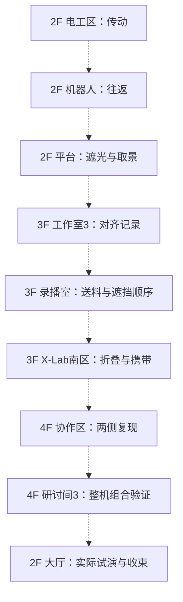

# 每一层、每一个房间的谜题设计

2026-10-29 · 房间覆盖版 v2 · 基于 Qwen 本地转录提炼的设计方法

**当前三层地图的 25 个房间/功能区各有一张谜题设计卡：二楼 8 个、三楼 10 个、四楼 7 个。** 每间围绕一个可独立观察、推断、操作并验证的问题展开。按钮次数、提示层数或换情境重复不另计关卡。茶水区也有轻谜题；X-Lab 小间也有专门设计。

上一版四关串联保留为机制样本，已经不再代表整栋楼的设计范围。以下 8 间为建议连续体验的主线候选，17 间为随时可玩的探索支线。两类都有实际操作和完成结果；主线标记不是按编号锁门，当前设计也不强迫玩家清完全部房间。既有楼梯、电梯、门洞、灰色地面与二楼开放平台保留，卫生间不在当前可进入房间列表中。

**全楼交付是设计；二楼已有隔离原生小样。** 现有评审入口包含传动操作台、[双屏同步](../review/SIGNAL_SYNC_20261029.md)、[太阳能竞赛与机器人往返](../review/MOTION_PUZZLES_20261029.md)，另有独立浏览器遮光样本。其余本文玩法尚未实现，小样没有正式剧情或持久存档接入。所有新增实验盒、图卡、夹具、NPC 记录和对白均为虚构玩法提案，不宣称是实拍现场已有器材或真实人员活动。

**全楼交互准则：** [直接操纵场景物件](../review/OBJECT_INTERACTION_20261029.md)，用拖动、旋转、插拔、实体操纵杆和摇杆完成主要动作；禁止用屏幕按钮排或默认热键提示替代。提示和记录通过实物按需打开，触屏行走采用模拟摇杆与轻触前往。

## 全楼一览

### 2F · 让物件可靠地运动、装配和显示

8/8 个房间有谜题设计。

| 房间 / 功能区 | 谜题 | 玩家主要做什么 | 路线定位 |
| --- | --- | --- | --- |
| 方程式车队 | [同一束阳光，谁跑得更远](#room-2-formula) | 用同一套零件预算造一辆太阳能小车，在相同日照片段中跑出更远距离。 | 可选探索 |
| 团队工作室 | [两台屏幕，两个版本](#room-2-team) | 让两个接收端同步显示当前源端的变化。 | 可选探索 |
| ASABE 机器人团队 | [送到了，还要回来](#room-2-robotics) | 完成起点装载、目标卸载和空载返回。 | 主线候选 |
| 二楼开放大平台 | [挡光，但别挡住镜头](#room-2-platform) | 拍清整块标记，并在来光换侧后再次做到。 | 主线候选 |
| 跨学科研讨室 | [三个视图，同一件东西](#room-2-seminar) | 让一件实体同时符合三个视图。 | 可选探索 |
| 机电开放实验室 · 电工区 | [动力停在哪](#room-2-electrical) | 把试件送到当前刻线，再处理反方向目标。 | 主线候选 |
| 机电开放实验室 · 机加工区 | [切完了，却取不出来](#room-2-machinery) | 保持定位完成轮廓，再完整取出试件。 | 可选探索 |
| 考拉工作室 | [把变化倒过来](#room-2-koala) | 用已观察到的操作还原一张新图案。 | 可选探索 |

### 3F · 让自己的操作能被观察、协作与复现

10/10 个房间有谜题设计。

| 房间 / 功能区 | 谜题 | 玩家主要做什么 | 路线定位 |
| --- | --- | --- | --- |
| 团队工作室 1 | [对面说的左边](#room-3-studio-1) | 让同一摆位符合面对面两人的观察。 | 可选探索 |
| 团队工作室 2 | [连起来以后过不去了](#room-3-studio-2) | 把两块送入终台区域并连成一个导通整体。 | 可选探索 |
| 团队工作室 3 | [两份记录差了一个节拍](#room-3-studio-3) | 找出同一事件在两份记录中的对应关系。 | 主线候选 |
| 团队工作室 4 | [盖上以后够不着](#room-3-studio-4) | 做成能真正开合的盒体。 | 可选探索 |
| 录播室 | [先送到，再遮住](#room-3-recording) | 让试件沿轨道到位，再拍清标记。 | 主线候选 |
| 开放研讨区 | [三拍里的共享工具](#room-3-seminar) | 在可逐拍暂停的三拍排练盘上完成四项任务。 | 可选探索 |
| 茶水休息区 | [慢慢备水，再稳稳送达](#room-3-pantry) | 四杯水位都在各自铜线之间，并将托盘稳定送到沙发茶几。 | 可选探索 |
| X-Lab 北区 | [它为什么抓了个空](#room-3-xlab-north) | 只在试件已经靠近并被托住时允许夹持。 | 可选探索 |
| X-Lab 南区 | [展开能用，收起卡住](#room-3-xlab-south) | 让同一台样机能完整展开、使用并收纳。 | 主线候选 |
| X-Lab 多功能小间 | [只看一面就被骗了](#room-3-xlab-box) | 用同一组镂空片同时形成两个方向的目标轮廓。 | 可选探索 |

### 4F · 让局部成功经得起组合、换位和条件变化

7/7 个房间有谜题设计。

| 房间 / 功能区 | 谜题 | 玩家主要做什么 | 路线定位 |
| --- | --- | --- | --- |
| 研讨间 1 | [找一个能推翻猜想的例子](#room-4-seminar-1) | 构造一个能区分两种解释的试验，再应用到新一组。 | 可选探索 |
| 研讨间 2 | [两辆车在窄轨上相遇](#room-4-seminar-2) | 让两辆车带着各自零件交换终点。 | 可选探索 |
| 研讨间 3 | [分开都能用，合起来卡住](#room-4-seminar-3) | 找出组合后新增的冲突，并完成当前整机复验。 | 主线候选 |
| 设备储藏室 | [柜门打开了，箱子出不来](#room-4-storage) | 取出长箱，并保留可恢复的归还路径。 | 可选探索 |
| A · 专注孵化区 | [空闲没事，开工就停](#room-4-focus-a) | 让同一接法在待机和工作状态都能运行。 | 可选探索 |
| B · 协作共创区 | [换一侧，也要成立](#room-4-collab-b) | 让同一套挡片布置在两侧来光下都能拍清。 | 主线候选 |
| C · 流动工位区 | [换一个工位，关系还在吗](#room-4-flex-c) | 用同一功能关系适配第二个工作位。 | 可选探索 |

## 房间之间怎样联系

相近房间共享操作语言，下一间改变限制或需要解释的现象；不同功能区则使用对应的工作台、显示器、白板、柜子、大桌和沙发。每间可单独试验，其他房间的发现提供帮助。全楼以知识与装置状态串联，支线完成不构成统一门槛。



虚线表示建议体验，不是强制房门解锁顺序。通过仍由当前物件和真实试验裁决；不要求补读便笺或先失败几次。大厅收束复用已有规则，不另算第 26 个房间谜题。

| 可选学习链 | 如何递进 |
| --- | --- |
| 2F 研讨室 → 3F 工作室1 → X-Lab 小间 | 三视图约束 → 面对面参照 → 同一实体的双视向轮廓 |
| 2F 机加工 → 3F 工作室4 → X-Lab 南区 → 4F 储藏室 | 保留加工基准 → 保留安装通道 → 保留折叠空间 → 保留取用退路 |
| 2F 考拉 → 3F X-Lab 北区 → 4F 研讨间1 | 从操作反推规则 → 区分输入组合 → 主动构造反例 |
| 3F 工作室2 → 4F 研讨间2 | 分开过口再连接 → 临时让位再交会 |
| 3F 开放研讨 → 4F 专注区 → 流动工位 | 共享工具调度 → 同时工作的容量 → 工位改变后的关系保持 |
| 3F 茶水区 | 2–3 分钟的低压力平衡与搬运；大桌和沙发成为玩法的一部分 |

### 节奏与完成后的变化

主线候选八关的纯谜题时间暂估 33–51 分钟；全部 25 间暂估 97–151 分钟。均未计跨楼移动和自由探索，也未做真人测时。首次制作仍可先做一个切片，但设计覆盖已扩展到全部房间，不能再把其余房间标成“以后考虑”。

主线结果服务于演示装置的运转、记录、运输与整机验证。支线结果优先改变本房间的可见状态：车跑通、盒能开合、同伴能喝到茶、柜内器材能取出。可在探索页回看完成过的作品，不向常驻任务栏塞入 25 项清单，也不把所有支线都绑定新背包物品。

## 逐间设计卡

每张卡都包含问题、竞争解释、三处线索、可区分解释的实验、反例、参考解、完成条件与变式。“制作者/试用者”是虚构记录作者的角色区分，不表示每间必须新增两名 NPC。可以由三名主要同学在不同时间留下记录；读到这些记录仍是可选帮助。

[提示规则与全楼难度曲线](GUIDANCE_AND_DIFFICULTY_20261029.md) · [待发送 Argon 审阅包](ARGON_REVIEW_PACKET_20261029.md)。以下等级是本地作者预测，待 Argon 审阅与真人试玩；提示须主动请求，把手和接口在场景可见，详细说明按需出现。

<a id="room-2-formula"></a>

### 2F · 方程式车队：同一束阳光，谁跑得更远

可选探索 · 运输与路径 · 目标体验 5–8 分钟（待试玩）

**实现状态：** [隔离原生小样](../review/MOTION_PUZZLES_20261029.md)，可走近工作台操作；没有正式剧情或持久存档接入。

**难度：** 入门 2 / 进阶 3（5 级制，未试玩）。

**教学顺序：** 先建议只调板角，与基准车比较；板尺寸、传动和侧光始终可操作，不以失败次数或读记录作为解锁条件。

**可读性要求：** 用赛道上拉开差距的位置引导观察，先不弹能量或传动公式。

**看见的问题：** 两辆相同的小车先得到同样里程；改装后，起步、阴影和复光三段的领先可能不同。

**玩家目标：** 用同一套零件预算造一辆太阳能小车，在相同日照片段中跑出更远距离。

**实际操作：** 在工作台上装太阳能板、转动板的支架、替换传动轮；把车放上试跑台，与同伴的基准车同场发车。赛后可保留上次车的轨迹再挑战。

**已有对象：** 机电实验台（`formula_workbench_0`）

**新增提案：** 可拆装太阳能小车、可调俯仰的太阳能板与三套传动轮、有里程标记的双车试跑台、复现同一日照片段的比赛灯与遮云片。本轮已在现有操作台侧边验证接近、点按进入与退出；不改变房间轮廓、门洞、人物脚底规则和楼层路线。近景的轨道与机械道具为新增游戏模型。

**三处线索：**

- 现场实物：太阳能板受光方向、车轮转动、经过阴影时的滑行和实际里程。
- 制作者记录：车队同学留下的两种板和传动轮的试车轨迹，记录起步段与终点但不排列优劣。
- 试用者记录：试跑同学标出同一日照片段中变暗区间的比赛条。

**两种解释：** “起步最快的车最后一定跑得最远” / “全程距离取决于受光、传动和整车负担的配合”。

**区分实验：** 先固定车身与传动，只改变板的朝向；再固定受光方向，换传动轮，对比起步、阴影段与最终里程。

**反例：** 起步领先不保证最后领先；大板获得更多输入也带来重量；在一种来光方向领先的摆法，换方向后未必仍领先。用完整实跑结果比较，不靠装备的稀有度决定胜负。

**作者参考解：** 没有唯一装配答案。寻找受光稳定且能带动整车的组合，比较它在完整日照片段中的累计距离。作者参考模型枚举板尺寸、板角度和传动比，接受所有超过同条件基准车的方案；具体参数是玩法抽象，之后用试玩调平衡。

**完成条件：** 同预算、同起点、同一日照回放、同一计时窗口下完成实际试跑，累计有效前进距离超过基准车。首胜即记录本房间完成；随后继续刷新个人纪录，不以试跑次数或读完记录为门槛。

**换情境应用：** 可选侧光与阴影挑战沿用相同比赛规则，每次让自己的车和基准车接受完全相同的光照；调试成果以场次分别记录。

**现场反馈：** 两辆车、轮子、板角和日照状态同步变化；共用同一计时窗口。记录页显示本轮实际轨迹的入影、复光、终点距离差，重试时可保留上轮停点。

**三层自选提示：** 先看两辆车在哪一段开始拉开距离。 → 保留其他零件，只改变板的朝向，再比较同一段赛道。 → 对照试车轨迹和日照比赛条，看看领先发生在起步、阴影还是复光之后。

**撤回与恢复：** 随时中止并回工作台；零件不消耗，离开或失焦中止未完成场次。重赛重放同一光照序列，个人纪录保留，不在后台计程。

**解完后的房间：** 车队房间留下玩家组装的小车、真实实跑纪录和可再次挑战的同伴车辆。

**转录方法依据：** [S02、S03、S10](TRANSCRIPT_EVIDENCE_20261029.md)。具体房间谜题是本项目原创提案，引用的是设计方法，不是原视频的精确关卡。

<a id="room-2-team"></a>

### 2F · 团队工作室：两台屏幕，两个版本

可选探索 · 记录与复现 · 目标体验 3–5 分钟（待试玩）

**实现状态：** [隔离原生小样](../review/SIGNAL_SYNC_20261029.md)，可走近工作台操作；没有正式剧情或持久存档接入。

**难度：** 入门 1 / 进阶 2（5 级制，未试玩）。

**教学顺序：** 先改一个清楚的图案角标，再修连接；复验时换新图案和接收端位置。

**可读性要求：** 线端、图案和传播过程始终可见，旧稿差异集中在两处，不藏坏像素。

**看见的问题：** 同伴两侧的屏幕都亮着，显示的却不是同一张修改稿。

**玩家目标：** 让两个接收端同步显示当前源端的变化。

**实际操作：** 在桌面模型中插拔信号线，切换源端测试图案，观察两个接收端。

**已有对象：** 工作桌（`team_desk_6`）、支架显示器（`team_monitor_front_9`）

**新增提案：** 桌面信号分配盒、两个版本的图案卡、可插拔模型信号线。新增物件在既有对象或房间内安排；源对象引用不代表已完成可达性和尺寸验收。

**三处线索：**

- 现场实物：实际线缆连接与两屏差异。
- 制作者记录：制作同学的修改前后图案。
- 试用者记录：试用同学注明接收时间的截图。

**两种解释：** “屏幕坏了一角” / “其中一路仍接着旧图案缓存”。

**区分实验：** 源端只改一个角标；比较哪些端点随之改变。

**反例：** 手动让两屏暂时显示同一张旧图，切换新图案后又分叉。

**作者参考解：** 当前源端接入分配盒，再分别接两个接收端；缓存支路可保留查看，但不能充当实时源。

**完成条件：** 当前连接下，两次不同的源端变化都传播到两个接收端；不以两张静态截图相同作为通过。

**换情境应用：** 交换两个接收端的位置，连接按功能保持正确，不按桌子左/右位置匹配。

**现场反馈：** 变化沿实际连接传播，停在缓存处时只显示旧角标，不直接指示该拔哪根线。

**三层自选提示：** 比较两个角标的变化。 → 只改源端一次，追踪变化到哪里停止。 → 对照修改稿和接收截图的先后。

**撤回与恢复：** 插线可撤回；测试不访问真实网络和文件。

**解完后的房间：** 工作室的共同演示画面恢复同步。

**可见演出顺序：**

1. 初见两台显示器都亮着，角标和局部图案不同；源端是一张当前编辑稿。
2. 玩家在真实插口之间拉线或点选两端，线的端点始终落在插口。
3. 源端改动后，同一个小图案脉冲沿已接通的线传播，接收屏在脉冲到达后才更新。
4. 缓存支路显示旧角标和停住的画面；第二次源端改动暴露偶然相同的旧图。
5. 复验成功后两屏继续跟随编辑，不覆盖全屏成功卡；可交换屏幕位置再试。

**转录方法依据：** [S03、S06、S10](TRANSCRIPT_EVIDENCE_20261029.md)。具体房间谜题是本项目原创提案，引用的是设计方法，不是原视频的精确关卡。

<a id="room-2-robotics"></a>

### 2F · ASABE 机器人团队：送到了，还要回来

主线候选 · 运输与路径 · 目标体验 5–7 分钟（待试玩）

**实现状态：** [隔离原生小样](../review/MOTION_PUZZLES_20261029.md)，可走近工作台操作；没有正式剧情或持久存档接入。

**难度：** 入门 2 / 进阶 3（5 级制，未试玩）。

**教学顺序：** 先用一小段轨道完成装卸，再遇到往返方向冲突；进阶才改变卸货支路。

**可读性要求：** 去程可见、返程失败点可回看，岔口凹纹在普通镜头就看得清。

**看见的问题：** 机器人把试件送到了，却在返程卡进同一个岔口。

**玩家目标：** 完成起点装载、目标卸载和空载返回。

**实际操作：** 点选台面轨道模块，旋转或换成直轨、转弯、单向模块；调整卸货台返程出口，分步或连续试跑。

**已有对象：** 机电实验台（`robotics_workbench_30`）、封闭式 3D 打印机（`robotics_printer_3d_37`）

**新增提案：** 低速桌面机器人、带方向标的模块轨道、装卸基座。本轮已在现有操作台侧边验证接近、点按进入与退出；不改变房间轮廓、门洞、人物脚底规则和楼层路线。近景的轨道与机械道具为新增游戏模型。

**三处线索：**

- 现场实物：岔口上的方向凹纹。
- 制作者记录：制作同学的送达记录。
- 试用者记录：试用同学标出返程停点的照片。

**两种解释：** “返程也能完全照走去程” / “轨道接通与方向允许是两件事”。

**区分实验：** 先走一个方向，再在相同配置下试返程，比较进入岔口的一侧。

**反例：** 一条视觉连续的最短路可以送达，但单向出口不能倒着进入。

**作者参考解：** 用支路形成回环，或把可双向的连接安排在往返共用段；接受能真实往返的不同布局。

**完成条件：** 机器人携带同一试件实际到达卸载基座，随后从可达轨道回到起点；不按“访问过两个点”判定。

**换情境应用：** 把卸载点换到另一条支路，保留方向与回程约束。

**现场反馈：** 车头在受阻入口停住并留下本次轨迹；没有隐形跳转或失败惩罚。

**三层自选提示：** 去程停靠与返程入口有什么不同？ → 从返程方向观察同一条凹纹。 → 把送达记录和返程停点叠起来。

**撤回与恢复：** 随时停机、退一步或重摆轨道，试件回到本次安全基座。

**解完后的房间：** 后续演示可观察到完整运输循环。

**可见演出顺序：**

1. 机器人停在装载台，夹爪合拢，试件从基座移到车载托盘；不突然出现在车上。
2. 沿轨道实际前进；轮子速度匹配位移，车头转向和单向凹纹能同时看见。
3. 到岔口先减速再按当前岔片转弯；受阻时车头停在实体入口，显示接触位置，不跳回起点。
4. 抵达卸载台后夹爪张开、试件落在目标托架，空托盘让返程状态可辨。
5. 返程沿当前配置真实走完；去程实线与返程点线仅在用户回看时叠加，不预画正确路线。
6. 回到装载台才形成完整循环记录；保持原镜头方位，同一画面看见失败岔口与相邻模块。

**转录方法依据：** [S02、S03、S07、S09](TRANSCRIPT_EVIDENCE_20261029.md)。具体房间谜题是本项目原创提案，引用的是设计方法，不是原视频的精确关卡。

<a id="room-2-platform"></a>

### 2F · 二楼开放大平台：挡光，但别挡住镜头

主线候选 · 光路与遮挡 · 目标体验 4–6 分钟（待试玩）

**难度：** 入门 2 / 进阶 3（5 级制，未试玩）。

**教学顺序：** 先让阴影和标记相交，再比较相机看见的内容；换侧光作应用。

**可读性要求：** 同屏给出真实阴影与拍摄结果，只标当前受阻物，不标正确摆位。

**看见的问题：** 试拍中的标记过亮；把白板推到相机前虽然变暗，却什么也看不到。

**玩家目标：** 拍清整块标记，并在来光换侧后再次做到。

**实际操作：** 移动白板、切换明确的试验灯条件、试拍并比较回放。

**已有对象：** 移动白板（`platform_whiteboard_41`）、拼接研讨桌（`platform_discussion_table_38`）、录制相机（`platform_camera_tripod_48`）

**新增提案：** 标记试件、局部校准试验灯。新增物件在既有对象或房间内安排；源对象引用不代表已完成可达性和尺寸验收。

**三处线索：**

- 现场实物：白板阴影覆盖。
- 制作者记录：制作同学留下的轮位痕迹。
- 试用者记录：记录同学的两张试拍。

**两种解释：** “只要画面变暗就可以” / “需要挡住来光，同时保留取景通路”。

**区分实验：** 保持镜头不动，只移动白板，分别看阴影和回放。

**反例：** 前方板遮住镜头；只成功一次的摆位也可能在换侧后失效。

**作者参考解：** 把板摆在来光与标记之间，保留相机至标记的视线；换侧后重新安排。

**完成条件：** 每次实际试拍同时满足标记四角可见和亮斑被挡；本关允许两次不同摆位，不能冒充四楼的同配置证明。

**换情境应用：** 另一侧来光是本关的第二情境。

**现场反馈：** 回放展示过曝、遮板或完整标记，阴影与实际板位同步。

**三层自选提示：** 暗下来不等于拍到了。 → 比较桌上的标记和相机里的标记。 → 看两张回放里多出来的那一片白色。

**撤回与恢复：** 白板移动可撤回，扫掠碰撞阻止穿过桌椅。

**解完后的房间：** 大厅获得清楚的试拍，蓝色构架和圆凳仍可通行与观察。

**转录方法依据：** [S04、S05、S10](TRANSCRIPT_EVIDENCE_20261029.md)。具体房间谜题是本项目原创提案，引用的是设计方法，不是原视频的精确关卡。 原四关机制样本编号：`L2`。

<a id="room-2-seminar"></a>

### 2F · 跨学科研讨室：三个视图，同一件东西

可选探索 · 空间与视角 · 目标体验 3–5 分钟（待试玩）

**难度：** 入门 2 / 进阶 3（5 级制，未试玩）。

**教学顺序：** 先用两视图排除一个解释，再加入第三视图；进阶含一个被遮住的支撑。

**可读性要求：** 图卡与实体摆在同一操作面，允许旋转实体查看，不考脑内记忆。

**看见的问题：** 按正面照片搭得很像，从侧面看却多出一层。

**玩家目标：** 让一件实体同时符合三个视图。

**实际操作：** 在桌面放置和堆叠模型块，旋转模型底座，叠看三张视图片。

**已有对象：** 拼接研讨桌（`seminar_discussion_table_49`）、移动白板（`seminar_whiteboard_52`）

**新增提案：** 三块可堆叠模型块、俯视与侧视透明片、小型旋转模型底座。新增物件在既有对象或房间内安排；源对象引用不代表已完成可达性和尺寸验收。

**三处线索：**

- 现场实物：模型底座的朝向缺口。
- 制作者记录：制作同学的俯视片。
- 试用者记录：试用同学的正面/侧面照片。

**两种解释：** “照片的朝向弄反了” / “前后遮挡让不同实体具有相同正面轮廓”。

**区分实验：** 保持正面轮廓不变，换一块的前后位置，再看侧面。

**反例：** 正面匹配的两个摆法，俯视占位或侧面高度不同。

**作者参考解：** 样例底面占位为 (0,0)、(1,0)、(1,1)，对应高度为 1、2、1；按全部投影接受等价实体，不按摆放顺序。

**完成条件：** 当前实体的俯视占位、正面轮廓、侧面轮廓同时匹配，且实体不悬空。

**换情境应用：** 换一张被部分遮住的侧视片，通过另两张约束缺失部分。

**现场反馈：** 只展示当前实体真实投影，不把正确块逐个锁定或标绿。

**三层自选提示：** 哪个视图能区分前后？ → 试着保持正面不变，只移动后面的块。 → 用底座缺口对齐三张图的朝向。

**撤回与恢复：** 拿起、堆放、旋转都可撤回，复位回到零件托盘。

**解完后的房间：** 桌上留下可以从三个方向核对的作品。

**转录方法依据：** [S01、S02、S09](TRANSCRIPT_EVIDENCE_20261029.md)。具体房间谜题是本项目原创提案，引用的是设计方法，不是原视频的精确关卡。

<a id="room-2-electrical"></a>

### 2F · 机电开放实验室 · 电工区：动力停在哪

主线候选 · 结构与装配 · 目标体验 3–5 分钟（待试玩）

**难度：** 入门 1 / 进阶 2（5 级制，未试玩）。

**教学顺序：** 先定位动力中断，再处理方向；返程目标沿用同一传动关系。

**可读性要求：** 电机、从动轮和试件分段可见，先反馈停在何处，再由玩家试装。

**看见的问题：** 电机转动，送料块不动，或在连接后朝错误方向移动。

**玩家目标：** 把试件送到当前刻线，再处理反方向目标。

**实际操作：** 装配齿轮、调整皮带路由和张力，试转并撤回。

**已有对象：** 传动装配操作台（`electrical_assembly_bench`）、元件收纳架（`electrical_parts_rack_67`）

**新增提案：** 拟议的返程刻线。新增物件在既有对象或房间内安排；源对象引用不代表已完成可达性和尺寸验收。

**三处线索：**

- 现场实物：齿间空隙与实际转动。
- 制作者记录：制作同学的旧试车条。
- 试用者记录：记录同学的试件位置照片。

**两种解释：** “电机没有动力” / “连接处断开、打滑或输出方向不对”。

**区分实验：** 只改一件零件，观察动力停止的位置是否改变。

**反例：** 接上了不等于送对方向；轮子转也可能伴随皮带打滑。

**作者参考解：** 现有向右模型为中尺寸齿轮、交叉皮带、正常张力；返程提案用相反皮带路由。

**完成条件：** 本次试件在合法传动中到达目标；当前代码仅实现向右，返程仍待实现。

**换情境应用：** 反向刻线让玩家迁移转向关系，而非重复初始配置。

**现场反馈：** 空转、咬死、打滑、反转有不同可见结果。

**三层自选提示：** 比较哪两处在动。 → 保持其他零件不动再试一次。 → 对照试车条和试件的前后位置。

**撤回与恢复：** 不消耗零件，离开/隐藏取消未完成运行。

**解完后的房间：** 传动台可被实际启动和反复演示。

**转录方法依据：** [S01、S02、S07、S10](TRANSCRIPT_EVIDENCE_20261029.md)。具体房间谜题是本项目原创提案，引用的是设计方法，不是原视频的精确关卡。 原四关机制样本编号：`L1`。

<a id="room-2-machinery"></a>

### 2F · 机电开放实验室 · 机加工区：切完了，却取不出来

可选探索 · 结构与装配 · 目标体验 4–6 分钟（待试玩）

**难度：** 入门 3 / 进阶 4（5 级制，未试玩）。

**教学顺序：** 先处理一个定位桥，后处理取出顺序；进阶改变夹持面。

**可读性要求：** 切口与夹具接触点可见，预览本次动作扫过的区域，不代选切割顺序。

**看见的问题：** 轮廓看起来正确，试件却失去定位，后一道槽切偏了。

**玩家目标：** 保持定位完成轮廓，再完整取出试件。

**实际操作：** 在模拟盒内调整夹具、旋转试件、选择可见轮廓段逐段试切。

**已有对象：** 机电实验台（`machinery_workbench_77`）、移动工具车（`machinery_tool_cart_88`）

**新增提案：** 封闭的模拟加工盒、可恢复泡沫试件、可移动夹具与轮廓片。新增物件在既有对象或房间内安排；源对象引用不代表已完成可达性和尺寸验收。

**三处线索：**

- 现场实物：试件定位孔与未切断的连接桥。
- 制作者记录：制作同学的加工草片。
- 试用者记录：试用同学留下的偏槽失败件。

**两种解释：** “轮廓片本身错误” / “过早切掉连接桥后，后续加工失去基准”。

**区分实验：** 先切桥与后切桥各试一次，比较同一条槽的位置。

**反例：** 每一段单独看都对，但失去定位后的累计轮廓无法装配。

**作者参考解：** 保留能维持基准的连接和夹持，完成主要轮廓后再释放试件；合法替代夹持与顺序同样接受。

**完成条件：** 每次模拟切削都有支撑，最终轮廓与孔位匹配，试件能沿取出通路离开夹具。

**换情境应用：** 第二块试件把连接桥换一侧，不能机械重复左右切割顺序。

**现场反馈：** 失去基准时整块偏移可见，错误切口留在本次模拟件上。

**三层自选提示：** 哪一步之后基准位置改变了？ → 先保留一处连接再比较。 → 把失败件的孔与草片基准叠齐。

**撤回与恢复：** 撤回恢复模拟试件；不操作真实机床，不消耗故事材料。

**解完后的房间：** 获得一件可检视的合格样件和失败对照。

**转录方法依据：** [S02、S03、S10](TRANSCRIPT_EVIDENCE_20261029.md)。具体房间谜题是本项目原创提案，引用的是设计方法，不是原视频的精确关卡。

<a id="room-2-koala"></a>

### 2F · 考拉工作室：把变化倒过来

可选探索 · 规则推断 · 目标体验 4–6 分钟（待试玩）

**难度：** 入门 2 / 进阶 3（5 级制，未试玩）。

**教学顺序：** 先独立体验一种变换，再组合两种；新非对称图案用于检验还原。

**可读性要求：** 保留同一次试验的前后图，不要求记住多张一闪而过的结果。

**看见的问题：** 同一排图形连续经过几个变换，最后已认不出原来的排列。

**玩家目标：** 用已观察到的操作还原一张新图案。

**实际操作：** 摆入带形状和填纹的图块，尝试变换，拖排操作顺序。

**已有对象：** 工作桌（`koala_desk_94`）、支架显示器（`koala_monitor_front_97`）

**新增提案：** 屏幕内的符号实验原型、输入/输出纸卡。新增物件在既有对象或房间内安排；源对象引用不代表已完成可达性和尺寸验收。

**三处线索：**

- 现场实物：可输入任意图案的实验台。
- 制作者记录：制作者的单步输入/输出卡。
- 试用者记录：试用者的一张完整变化记录。

**两种解释：** “按原顺序再做一遍就能还原” / “必须倒过来处理操作次序与每个操作的逆变换”。

**区分实验：** 一次只用一个操作；再比较先翻转后移位与先移位后翻转。

**反例：** 部分对称图案被错误顺序也能还原，换成不对称图案就失败。

**作者参考解：** 对“左移一格→反序→切换填纹”逆序处理：先切换填纹、再反序、最后右移一格；可用多次左移构成等价右移。

**完成条件：** 同一逆操作序列还原新的不对称输入，不用背固定符号答案。

**换情境应用：** 改变序列长度与起始图案，规则不变。

**现场反馈：** 每步留下实际中间排列；不直接把未知操作命名成答案。

**三层自选提示：** 先找哪种操作做两遍会抵消。 → 用不对称图案比较两种先后顺序。 → 对照单步卡，尝试从最后一张往回看。

**撤回与恢复：** 逐步撤回，测试图案随时更换，无真实文件修改。

**解完后的房间：** 工作室屏幕上的损坏示范得到还原。

**转录方法依据：** [S06、S08、S10](TRANSCRIPT_EVIDENCE_20261029.md)。具体房间谜题是本项目原创提案，引用的是设计方法，不是原视频的精确关卡。

<a id="room-3-studio-1"></a>

### 3F · 团队工作室 1：对面说的左边

可选探索 · 空间与视角 · 目标体验 3–5 分钟（待试玩）

**难度：** 入门 1 / 进阶 2（5 级制，未试玩）。

**教学顺序：** 同一物体从面对面两侧各看一次，再移动一次核对两人的描述。

**可读性要求：** 桌面有共同参照物，左右称呼必须附观察者位置。

**看见的问题：** 两位同学都说“左边”，照着摆却互相矛盾。

**玩家目标：** 让同一摆位符合面对面两人的观察。

**实际操作：** 从两侧查看桌面，移动图块，转动观察用的纸片。

**已有对象：** 工作桌（`studio_1_desk_0`）、移动白板（`studio_1_whiteboard_57`）

**新增提案：** 桌面四象限摆位板、四枚不同形状的模型、两侧视角照片。新增物件在既有对象或房间内安排；源对象引用不代表已完成可达性和尺寸验收。

**三处线索：**

- 现场实物：摆位板固定的缺口。
- 制作者记录：北侧同学的局部照片。
- 试用者记录：南侧同学的手绘观察。

**两种解释：** “其中一份记录错了” / “记录分别使用了观察者自己的左右”。

**区分实验：** 保持一个图块不动，比较它在两侧记录中的位置。

**反例：** 只对上一侧的照片，另一侧会左右颠倒。

**作者参考解：** 先用缺口建立共同参照，再将面对面记录转到同一坐标系；不改变桌椅真实朝向。

**完成条件：** 当前模型同时满足两侧可见关系，不比较玩家面朝方向，也不接受只翻转屏幕截图。

**换情境应用：** 加入从短边拍摄的第三张照片，应用同一参照方法。

**现场反馈：** 两侧回放忠实显示当前摆位与遮挡。

**三层自选提示：** 照片里的缺口在哪边？ → 同一个不动的图块，在对面叫什么位置？ → 把两份记录的参照方向对齐。

**撤回与恢复：** 图块移动可撤回，所有原家具位置保留。

**解完后的房间：** 两组工位能按照同一张布置图沟通。

**转录方法依据：** [S02、S04、S09](TRANSCRIPT_EVIDENCE_20261029.md)。具体房间谜题是本项目原创提案，引用的是设计方法，不是原视频的精确关卡。

<a id="room-3-studio-2"></a>

### 3F · 团队工作室 2：连起来以后过不去了

可选探索 · 运输与路径 · 目标体验 4–6 分钟（待试玩）

**难度：** 入门 2 / 进阶 3（5 级制，未试玩）。

**教学顺序：** 先发现整体过不了窄口，再用可拆连接保持两端功能。

**可读性要求：** 窄口宽度、部件宽度和终台接点可同时比较。

**看见的问题：** 连体滑块能同时触达终台，但在中途窄口卡住；单块能通过却接不通终台。

**玩家目标：** 把两块送入终台区域并连成一个导通整体。

**实际操作：** 连接、分离、推动两个滑块，观察连体的占地与触点。

**已有对象：** 工作桌（`studio_2_desk_58`）、移动白板（`studio_2_whiteboard_115`）

**新增提案：** 带窄颈的桌面托盘、两块可连接滑块、双触点终台。新增物件在既有对象或房间内安排；源对象引用不代表已完成可达性和尺寸验收。

**三处线索：**

- 现场实物：窄口与连接后宽度的实物关系。
- 制作者记录：制作者的连接触点图。
- 试用者记录：试用者的过口失败记录。

**两种解释：** “应该一开始就组好” / “可以通过窄口以后再连接”。

**区分实验：** 分别测试单块和连体通过同一窄口。

**反例：** 两块分别停在终台触点上也不导通，中间还缺连接。

**作者参考解：** 先分离通过，再在宽区连接并整体移到触点。草模单块宽 1、连体宽 2、窄口宽 1.4；实际尺寸待原生摆位校准。

**完成条件：** 两块实际通过合法路径，到终区后保持连接，并同时压到两处触点。

**换情境应用：** 连接方向换成纵向，重新判断在哪个区域组装更合适。

**现场反馈：** 卡住的边缘与缺失的中间连接可见。

**三层自选提示：** 连接改变了哪一个尺寸？ → 分别试单块和连体。 → 比较过口记录与终台触点图。

**撤回与恢复：** 可拉回、拆开、撤回；不能丢弃或销毁滑块。

**解完后的房间：** 托盘内的双触点装置导通。

**转录方法依据：** [S03、S07、S08](TRANSCRIPT_EVIDENCE_20261029.md)。具体房间谜题是本项目原创提案，引用的是设计方法，不是原视频的精确关卡。

<a id="room-3-studio-3"></a>

### 3F · 团队工作室 3：两份记录差了一个节拍

主线候选 · 记录与复现 · 目标体验 3–5 分钟（待试玩）

**难度：** 入门 2 / 进阶 3（5 级制，未试玩）。

**教学顺序：** 先对齐一个共同事件，再用第二个检验是否偶然，最后换一段记录。

**可读性要求：** 可拖动记录条并来回播放，重复事件的差异靠实物顺序可解释。

**看见的问题：** 摄像记录说试件先到，传感记录却像是先关挡片。

**玩家目标：** 找出同一事件在两份记录中的对应关系。

**实际操作：** 滑动纸带，叠看公共事件，重跑一个短试验核对对应。

**已有对象：** 工作桌（`studio_3_desk_116`）、支架显示器（`studio_3_monitor_front_122`）

**新增提案：** 相机事件纸带、传感器事件纸带、可滑动对齐槽。新增物件在既有对象或房间内安排；源对象引用不代表已完成可达性和尺寸验收。

**三处线索：**

- 现场实物：试验中的公共闪光标记。
- 制作者记录：拍摄同学的连续图帧。
- 试用者记录：操作同学的碰停和送料纸带。

**两种解释：** “两套设备描述了不同试验” / “两份记录的起始时刻不同”。

**区分实验：** 先只对一个重复闪光，再用远处另一个独特事件复核。

**反例：** 对齐某次闪光看似正确，远处的碰停事件仍错位。

**作者参考解：** 用两个相隔的公共事件固定相对偏移，再解释中间的送料/挡片顺序。

**完成条件：** 两个公共事件与新一轮实际试验都对应；单次点击时间戳或读完纸带不授予完成。

**换情境应用：** 换一组不同起始偏移的记录，保留事件关系。

**现场反馈：** 重叠处显示实际图帧与传感痕迹，错位保留而不是自动吸到答案。

**三层自选提示：** 一个重复标记能唯一定位吗？ → 用远处另一个事件复核。 → 看两位同学记录里共同出现的异常动作。

**撤回与恢复：** 纸带偏移可撤回，原始记录保持只读。

**解完后的房间：** 得到可解释送料过程的同步回放；回看不替代真实送料。

**转录方法依据：** [S03、S05、S10](TRANSCRIPT_EVIDENCE_20261029.md)。具体房间谜题是本项目原创提案，引用的是设计方法，不是原视频的精确关卡。

<a id="room-3-studio-4"></a>

### 3F · 团队工作室 4：盖上以后够不着

可选探索 · 结构与装配 · 目标体验 4–6 分钟（待试玩）

**难度：** 入门 2 / 进阶 3（5 级制，未试玩）。

**教学顺序：** 先装成可开启的简单盒，再加入会遮住安装面的盖板。

**可读性要求：** 每次安装都能看到下一步可达性，错误装配可立即拆回。

**看见的问题：** 盖板装上了，但铰链轴还没有穿到位，之后也伸不进安装口。

**玩家目标：** 做成能真正开合的盒体。

**实际操作：** 装卸支撑、铰链轴与盖板；从侧面看安装通道并试开合。

**已有对象：** 工作桌（`studio_4_desk_174`）、移动白板（`studio_4_whiteboard_231`）

**新增提案：** 透明演示盒、可拆铰链轴、盖板与支撑件。新增物件在既有对象或房间内安排；源对象引用不代表已完成可达性和尺寸验收。

**三处线索：**

- 现场实物：透明壳上的安装口。
- 制作者记录：制作者的局部爆炸图。
- 试用者记录：试用者的开盖失败记录。

**两种解释：** “盖板尺寸不对” / “局部能安装不代表后续操作仍可达”。

**区分实验：** 盖板保持拆下状态先装轴，与先盖板的路径作比较。

**反例：** 零件全部在画面里，也可能只是搭在一起，轴没有穿过两个轴孔。

**作者参考解：** 先建立可达的支撑与轴连接，再合上遮住安装口的盖板；能保持操作通路的其他顺序也成立。

**完成条件：** 铰链轴实际连接两侧、盖板运动无碰撞，并完成一次打开与关闭。

**换情境应用：** 交换铰链侧，重新安排安装次序。

**现场反馈：** 受阻安装口、未贯穿轴孔和试开时脱离分别可见。

**三层自选提示：** 哪一步遮住了安装通道？ → 先试一下轴能从哪里穿入。 → 对照爆炸图中两个轴孔的位置。

**撤回与恢复：** 可拆回，不需要找新轴或消耗工具。

**解完后的房间：** 展示盒可反复开合。

**转录方法依据：** [S02、S03、S05](TRANSCRIPT_EVIDENCE_20261029.md)。具体房间谜题是本项目原创提案，引用的是设计方法，不是原视频的精确关卡。

<a id="room-3-recording"></a>

### 3F · 录播室：先送到，再遮住

主线候选 · 光路与遮挡 · 目标体验 3–5 分钟（待试玩）

**难度：** 入门 3 / 进阶 4（5 级制，未试玩）。

**教学顺序：** 前关静态解先在这里失败，再让玩家找出送料与遮挡的先后。

**可读性要求：** 停机不会清空状态，夹持止挡可靠，完全取消抢时机要求。

**看见的问题：** 静态照片清楚，试件却停在挡片前，送不到拍摄位置。

**玩家目标：** 让试件沿轨道到位，再拍清标记。

**实际操作：** 移开挡片、分段送料、复位挡片、试拍；无需抢短暂时间窗。

**已有对象：** 工作桌（`recording_desk_234`）、录制相机（`recording_camera_tripod_233`）

**新增提案：** 低速送料演示盒、可平移挡片。新增物件在既有对象或房间内安排；源对象引用不代表已完成可达性和尺寸验收。

**三处线索：**

- 现场实物：挡片与轨道交叉处。
- 制作者记录：操作同学的碰停条。
- 试用者记录：记录同学的清楚静态照片。

**两种解释：** “传动又失效了” / “静态正确摆位挡住了到达终态的通路”。

**区分实验：** 保持传动不变，只移开挡片，看试件能否越过交叉点。

**反例：** 永久移开挡片能送料却过曝；一直保留遮光又不能送达。

**作者参考解：** 先让通路开放，送料到实体止挡，之后恢复遮光再试拍。

**完成条件：** 本轮试件真实沿轨道送达，随后本轮取景与遮光同时成立。

**换情境应用：** 反向退回试件再复现；不能用旧回放替代新过程。

**现场反馈：** 发生在哪里的碰停、过曝和清楚画面各自呈现。

**三层自选提示：** 比较试件停点和挡片的位置。 → 保持传动不变，暂时移开挡片。 → 送料条与静态照片描述的是同一时刻吗？

**撤回与恢复：** 停机、反向、撤回与重摆均可用；失焦取消运行。

**解完后的房间：** 录播同学能完成有真实送料过程的试拍。

**转录方法依据：** [S02、S03、S05](TRANSCRIPT_EVIDENCE_20261029.md)。具体房间谜题是本项目原创提案，引用的是设计方法，不是原视频的精确关卡。 原四关机制样本编号：`L3`。

<a id="room-3-seminar"></a>

### 3F · 开放研讨区：三拍里的共享工具

可选探索 · 共享条件与协作 · 目标体验 4–6 分钟（待试玩）

**难度：** 入门 2 / 进阶 3（5 级制，未试玩）。

**教学顺序：** 两项任务先共享一个工具，再加入前后依赖；每拍由玩家确认。

**可读性要求：** 工具占用与任务前提在排练盘上呈现，三拍不等于三秒倒计时。

**看见的问题：** 每项任务单独都能做，排在一起却有两项同时占用唯一的相机。

**玩家目标：** 在可逐拍暂停的三拍排练盘上完成四项任务。

**实际操作：** 把任务模块放进三列拍位，绑定所用工具，逐拍演示模型人的行动。

**已有对象：** 拼接研讨桌（`seminar_discussion_table_238`）、移动白板（`seminar_whiteboard_241`）

**新增提案：** 三拍桌面排练盘、相机/操作台磁片、四张任务模块。新增物件在既有对象或房间内安排；源对象引用不代表已完成可达性和尺寸验收。

**三处线索：**

- 现场实物：只有一枚相机资源的实物排练盘。
- 制作者记录：拍摄同学的 A/B 拍摄需求卡。
- 试用者记录：制作同学的 B 装配与对照要求卡。

**两种解释：** “每队各排自己的任务就够了” / “必须同时处理工具占用和前置结果”。

**区分实验：** 先交换两个拍摄任务的先后，再检查装配是否已完成。

**反例：** 不抢工具的顺序也可能让 B 在未装配前拍摄；每队局部正确不代表整体可执行。

**作者参考解：** 第一拍并行拍 A 与装 B，第二拍拍 B，第三拍比较两份照片。三个拍位是可见桌面机构，不是现实倒计时。

**完成条件：** 每拍工具占用不冲突，拍 B 依赖装 B，对照依赖两张实际产出的照片；排完还须真实跑完三拍。

**换情境应用：** 将相机改为两枚后，辨认哪些等待可消除，哪些因果依赖仍存在。

**现场反馈：** 冲突时两条行动同时指向同一工具；缺前置时任务模块显示空托盘。

**三层自选提示：** 哪一件工具被同时需要？ → 把资源等待与结果依赖分开看。 → 对照两位同学的需求卡，找能同时开始的任务。

**撤回与恢复：** 按拍撤回，所有任务产物只属于模拟盘。

**解完后的房间：** 白板旁能运行一遍完整协作排练。

**转录方法依据：** [S02、S05、S10](TRANSCRIPT_EVIDENCE_20261029.md)。具体房间谜题是本项目原创提案，引用的是设计方法，不是原视频的精确关卡。

<a id="room-3-pantry"></a>

### 3F · 茶水休息区：慢慢备水，再稳稳送达

可选探索 · 平衡与搬运 · 目标体验 4–7 分钟（待试玩）

**实现状态：** [隔离原生小样](../review/PANTRY_WATER_20261030.md)，可走近工作台操作；没有正式剧情或持久存档接入。

**难度：** 入门 2 / 进阶 3（5 级制，未试玩）。

**教学顺序：** 先接水和停水，再发现单纯等水量或换位不够；允许水位区间内微调，进阶再改变支撑线。

**可读性要求：** 铜线、水面、细流与倾斜同时可见；慢流为用户明确要求，搬运不考精细操作。

**看见的问题：** 四杯都要备水；只让托盘平，或者只把水位接到中间，都不够。

**玩家目标：** 四杯水位都在各自铜线之间，并将托盘稳定送到沙发茶几。

**实际操作：** 移杯到出水口，拨阀接水和停水；握杯移到水槽倒回多余的水，再摆杯试提。

**已有对象：** 深灰色共享长桌（`pantry_pantry_island_250`）、双人沙发（`pantry_sofa_246`）、双人沙发（`pantry_sofa_248`）

**新增提案：** 带中心提手的模型托盘、四只带不同铜色水位区间的空杯、慢流出水装置与橙色阀柄、倒水槽与可见杯垫。隔离小样已在既有大桌上加入独立茶盘，送达后显示在 pantry_lounge_coffee_table_249；房间尺寸、桌椅位置、碰撞和原画不变。

**三处线索：**

- 现场实物：杯中水位与托盘倾斜。
- 制作者记录：备茶同学留下的杯垫痕迹。
- 试用者记录：接茶同学的上一轮摆位图。

**两种解释：** “左右杯数相同就平衡” / “水量和离提手的距离共同影响倾斜”。

**区分实验：** 保持杯位不变只补少量水，再把同一杯从内侧换到外侧比较。

**反例：** 空杯也能平，但不能送达；四杯都接到区间中心，换位仍不能平衡。

**作者参考解：** 范围中心为60、90、120、150 ml，各允许±8 ml；样例实际水量65、85、115、155 ml，杯序A、D、C、B时力矩为0。也接受其他合格水量与摆法。

**完成条件：** 四杯全部回到托盘，水量分别在要求范围内，力矩绝对值≤8；同一配置完成提起和送达。

**换情境应用：** 提手换到另一条可见支撑线后重摆；可选进阶，不影响主线。

**现场反馈：** 出水细流、水面缓慢上升、杯身铜线与托盘倾斜同步反映模型。

**三层自选提示：** 先对照四只杯各自的两道铜线。 → 水量合格也可能倾斜，比较同一杯在内侧和外侧时的变化。 → 铜线之间留有余量，试着少量补水或倒回。

**撤回与恢复：** 关阀、移杯、失焦立即停水；握杯在水槽上倒回，重新接水；不消耗剧情物品。

**解完后的房间：** 当前隔离小样：茶盘从大桌移到沙发茶几，保留本次送达结果。后续提案：两侧同学坐下来喝茶；NPC 行为与正式存档尚未接入。

**转录方法依据：** [S04、S07、S10](TRANSCRIPT_EVIDENCE_20261029.md)。具体房间谜题是本项目原创提案，引用的是设计方法，不是原视频的精确关卡。

<a id="room-3-xlab-north"></a>

### 3F · X-Lab 北区：它为什么抓了个空

可选探索 · 规则推断 · 目标体验 4–6 分钟（待试玩）

**难度：** 入门 2 / 进阶 3（5 级制，未试玩）。

**教学顺序：** 一次只触发一个传感器，再比较同时触发；最后换试件验证。

**可读性要求：** 传感器接触和夹爪动作可分步看，声光颜色仅辅助表达。

**看见的问题：** 试件还没托稳，模型夹爪就动作；另一种连接又始终不动。

**玩家目标：** 只在试件已经靠近并被托住时允许夹持。

**实际操作：** 单独或同时触发传感器，更换连接片，实际放入试件。

**已有对象：** 工作桌（`xlab_north_desk_266`）、支架显示器（`xlab_north_monitor_front_269`）

**新增提案：** 双传感器实验座、形状不同的测试块、可更换逻辑连接片。新增物件在既有对象或房间内安排；源对象引用不代表已完成可达性和尺寸验收。

**三处线索：**

- 现场实物：可分别触发的两个传感区。
- 制作者记录：制作者的单传感测试记录。
- 试用者记录：试用者留下的抓空/未抓照片。

**两种解释：** “有任何一个输入就足够” / “两个输入需要在同一状态成立”。

**区分实验：** 比较只有靠近、只有托住和两者同时存在时的输出。

**反例：** “任一输入”看似容易启动，却会抓空；只按两次按钮不能代替当前两个物理状态。

**作者参考解：** 选择使两输入共同成立才输出的连接关系，并按实物接通夹爪支路。

**完成条件：** 当前连接通过双输入有效、两种单输入无效的试件测试；不是靠记住连接片名称。

**换情境应用：** 交换两个输入端位置，保持功能关系。

**现场反馈：** 夹爪启动/等待与当前输入痕迹一起出现，声音不承担唯一信息。

**三层自选提示：** 比较抓空时哪一路已经有响应。 → 每次只触发一个输入，再同时试一次。 → 对照单传感记录与失败照片。

**撤回与恢复：** 夹爪停机即松开，试件可取回，连接可撤回。

**解完后的房间：** 桌面原型能可靠接取试件。

**转录方法依据：** [S03、S08、S10](TRANSCRIPT_EVIDENCE_20261029.md)。具体房间谜题是本项目原创提案，引用的是设计方法，不是原视频的精确关卡。

<a id="room-3-xlab-south"></a>

### 3F · X-Lab 南区：展开能用，收起卡住

主线候选 · 结构与装配 · 目标体验 4–6 分钟（待试玩）

**难度：** 入门 3 / 进阶 4（5 级制，未试玩）。

**教学顺序：** 展开能工作后尝试收起，在碰到的铰链处重新安排线路。

**可读性要求：** 让展开、折叠和卡住使用同一几何，不能用两张状态图片替换。

**看见的问题：** 展开时能工作，折叠到一半却夹住连接带或顶住另一块盖片。

**玩家目标：** 让同一台样机能完整展开、使用并收纳。

**实际操作：** 改走连接带的可见槽，折叠两块盖片，测试展开后的导通。

**已有对象：** 工作桌（`xlab_south_desk_322`）、支架显示器（`xlab_south_monitor_front_325`）

**新增提案：** 可折叠展示盒样机、独立柔性连接带、两块宽窄盖片。新增物件在既有对象或房间内安排；源对象引用不代表已完成可达性和尺寸验收。

**三处线索：**

- 现场实物：实际折痕与铰链活动范围。
- 制作者记录：制作者的展开结构草图。
- 试用者记录：试用者的半折叠碰停照片。

**两种解释：** “外壳需要缩小” / “连接带路径和盖片动作顺序占用了铰链空间”。

**区分实验：** 只改连接带路径，比较碰停是否还出现；再比较宽窄盖片的先后。

**反例：** 强行拔掉连接带可以合上，展开后却不能工作。

**作者参考解：** 把连接带沿铰链预留槽布置，先收进内侧窄片，再合外侧宽片；接受无碰撞且保持连接的替代顺序。

**完成条件：** 同一实例完整展开/工作/折叠，连接不中断、壳体不相交，收纳尺寸符合模板。

**换情境应用：** 加上最终挡片附件后复测，不沿用空壳成功记录。

**现场反馈：** 夹线位置与盖片相碰的位置可见，试折在碰撞前停止。

**三层自选提示：** 卡住的是线还是盖片？ → 先保持盖片不动，只换线的路径。 → 把展开草图和半折叠照片放在一起看。

**撤回与恢复：** 逐段展开或撤回，部件不破坏；运输中保持同一对象身份。

**解完后的房间：** 演示盒可以实际携带上楼与返回大厅。

**转录方法依据：** [S02、S03、S05](TRANSCRIPT_EVIDENCE_20261029.md)。具体房间谜题是本项目原创提案，引用的是设计方法，不是原视频的精确关卡。

<a id="room-3-xlab-box"></a>

### 3F · X-Lab 多功能小间：只看一面就被骗了

可选探索 · 空间与视角 · 目标体验 3–5 分钟（待试玩）

**难度：** 入门 3 / 进阶 4（5 级制，未试玩）。

**教学顺序：** 先以一个视向找候选，再用第二视向排除；进阶只改一个轮廓。

**可读性要求：** 旋转的是展示托架，镜头与建筑不转，保留前后基准刻线。

**看见的问题：** 从正面看是完整轮廓，转到侧面却出现缺口。

**玩家目标：** 用同一组镂空片同时形成两个方向的目标轮廓。

**实际操作：** 在小展示台上平移、升降有支撑的镂空片，并旋转观察托架。

**已有对象：** 当前数据未摆独立对象。

**新增提案：** 新增便携透光展示台、两块独立镂空片、可旋转模型托架。当前 floor_3.json 中本房间没有独立对象；展示台与全部道具均为新增提案，必须先量测可达地面和门口净空。

**三处线索：**

- 现场实物：镂空片的真实轮廓。
- 制作者记录：制作者的正面目标片。
- 试用者记录：试用者的侧面目标片。

**两种解释：** “把正面拼满就完成了” / “前后距离与高度会改变另一个方向的重叠”。

**区分实验：** 保持正面轮廓不变，改变一片前后距离，看侧面变化。

**反例：** 把两片完全贴合可满足一面，但另一面投影宽度不对。

**作者参考解：** 利用两张片的互补缺口，分别满足两个视向的重叠关系；作者图案与精确槽距须在后续白模中确定，当前不虚构世界坐标。

**完成条件：** 同一实体摆位在两个机位都匹配完整轮廓，且每片仍在实体支撑内；不得用镜头切换换一套物件。

**换情境应用：** 其中一张目标片改为局部遮挡，利用另一方向补足信息。

**现场反馈：** 两面实时呈现同一几何，暴露遮挡差异。

**三层自选提示：** 哪一个方向还存在缺口？ → 让正面不变，试着只改前后距离。 → 比较两张目标片共有的边。

**撤回与恢复：** 所有槽位可退出与撤回；装置不能堵住小间门口。

**解完后的房间：** 小间成为有独立玩法的双视向展台。

**转录方法依据：** [S01、S02、S09](TRANSCRIPT_EVIDENCE_20261029.md)。具体房间谜题是本项目原创提案，引用的是设计方法，不是原视频的精确关卡。

<a id="room-4-seminar-1"></a>

### 4F · 研讨间 1：找一个能推翻猜想的例子

可选探索 · 规则推断 · 目标体验 4–6 分钟（待试玩）

**难度：** 入门 2 / 进阶 3（5 级制，未试玩）。

**教学顺序：** 先提供两个都符合旧例的解释，再让玩家主动构造区分例。

**可读性要求：** 展示结果一致的旧例，但不在选项标签里直接说出新例答案。

**看见的问题：** 已给的样例同时支持“形状相同”和“填纹相同”两种解释，下一组却分歧了。

**玩家目标：** 构造一个能区分两种解释的试验，再应用到新一组。

**实际操作：** 自由组成两枚图块的配对，送入实验窗口，保存真实结果。

**已有对象：** 移动白板（`seminar_1_whiteboard_0`）

**新增提案：** 可装在白板上的分类实验板、形状/填纹各不相同的磁片。新增物件在既有对象或房间内安排；源对象引用不代表已完成可达性和尺寸验收。

**三处线索：**

- 现场实物：实验板实际接受/拒绝的反馈。
- 制作者记录：制作者的相关样例。
- 试用者记录：试用者对新样例的两种预测。

**两种解释：** “分类只比较形状” / “分类只比较填纹”。

**区分实验：** 选择形状相同但填纹不同，或相反的配对。

**反例：** 继续测试形状与填纹都相同的样例，只会重复旧信息。

**作者参考解：** 先用一个两假设预测不同的配对区分规则，再按实际规则构造一个全新有效配对；不要求读提示或答文字选择题。

**完成条件：** 实际构造的区分案例与迁移案例符合当前实验规则；规则本局固定，不在试错中偷偷改变。

**换情境应用：** 换一组图块，仍须用已发现关系判断，图块颜色不是唯一编码。

**现场反馈：** 接受/拒绝与测试样例留在板上，不自动把未知规则写成答案。

**三层自选提示：** 这个样例能让两种解释产生不同预测吗？ → 把形状和填纹拆开变化。 → 对照两份预测，挑它们意见不同的样例。

**撤回与恢复：** 磁片可取回重组；记录只读，不改变规则。

**解完后的房间：** 研讨板留下可复核的反例与新例。

**转录方法依据：** [S06、S10、S11](TRANSCRIPT_EVIDENCE_20261029.md)。具体房间谜题是本项目原创提案，引用的是设计方法，不是原视频的精确关卡。

<a id="room-4-seminar-2"></a>

### 4F · 研讨间 2：两辆车在窄轨上相遇

可选探索 · 运输与路径 · 目标体验 4–6 分钟（待试玩）

**难度：** 入门 3 / 进阶 4（5 级制，未试玩）。

**教学顺序：** 先看到两车不能相穿，再尝试用侧位让车；进阶改两车长度。

**可读性要求：** 车长、会车位和前后退路同屏可见，随时暂停并撤回。

**看见的问题：** 两辆车都要到对面，直接互相推进只会顶在中间。

**玩家目标：** 让两辆车带着各自零件交换终点。

**实际操作：** 切换岔片，分步前进或后退，把一辆车停进侧线。

**已有对象：** 拼接研讨桌（`seminar_2_discussion_table_2`）、移动白板（`seminar_2_whiteboard_5`）

**新增提案：** 单线模型轨道、一格会让支线、两辆装载不同零件的小车。新增物件在既有对象或房间内安排；源对象引用不代表已完成可达性和尺寸验收。

**三处线索：**

- 现场实物：轨宽与一格侧线。
- 制作者记录：制作者的两个终点装配需求。
- 试用者记录：试用者的相遇停点记录。

**两种解释：** “只要轮流前进就能交会” / “需要临时让出共用通路”。

**区分实验：** 保持两车在主线上试一次，再让一辆退入侧线比较。

**反例：** 车头越过对方但把零件留在原地，不算完成运输。

**作者参考解：** 一辆完整进入会让支线，另一辆通过并到位，第一辆再出支线到另一端。

**完成条件：** 两辆实体沿合法轨道各携原零件到达对应终点，不能互穿或交换身份。

**换情境应用：** 支线只能容纳短车，新增长载荷后重新选择谁让行。

**现场反馈：** 碰停、岔片方向与装载归属可见，逐步推进不计反应速度。

**三层自选提示：** 现在哪一段只能容纳一辆车？ → 找一个可以暂时离开主线的位置。 → 对照载荷长度与侧线的实际长度。

**撤回与恢复：** 可倒车、撤回或归位，不丢零件。

**解完后的房间：** 研讨桌上的双向运输模型跑通。

**转录方法依据：** [S03、S07、S08](TRANSCRIPT_EVIDENCE_20261029.md)。具体房间谜题是本项目原创提案，引用的是设计方法，不是原视频的精确关卡。

<a id="room-4-seminar-3"></a>

### 4F · 研讨间 3：分开都能用，合起来卡住

主线候选 · 记录与复现 · 目标体验 5–8 分钟（待试玩）

**难度：** 入门 4 / 进阶 5（5 级制，未试玩）。

**教学顺序：** 两个组件分别成功再整机试验，新增冲突必须来自实际组合。

**可读性要求：** 失败时标接触位置和当前版本，只保留本次可复验结果。

**看见的问题：** 传动和遮光各自的试验都成功，装进同一个盒里却碰到送料件。

**玩家目标：** 找出组合后新增的冲突，并完成当前整机复验。

**实际操作：** 查看附件的活动包络，移动外侧支架，试运行整机并比较旧记录。

**已有对象：** 拼接研讨桌（`seminar_3_discussion_table_7`）、移动白板（`seminar_3_whiteboard_10`）

**新增提案：** 整机装配底座、可移动附件支架、各分系统的试验记录。新增物件在既有对象或房间内安排；源对象引用不代表已完成可达性和尺寸验收。

**三处线索：**

- 现场实物：当前整机的碰停位置。
- 制作者记录：机械制作者的分体送料记录。
- 试用者记录：记录同学的分体遮光回放。

**两种解释：** “某个分系统的原理错了” / “两个正确分系统共享了同一段活动空间”。

**区分实验：** 先卸下一个附件观察送料，再装回不同支架位置，比较光路是否仍成立。

**反例：** 拆掉挡片可以送料，却失去遮光；旧版本两个“通过”不能证明当前整机通过。

**作者参考解：** 把附件支撑移到送料活动范围之外，同时保持侧挡片有效遮光；对当前整机重新跑送料与两侧试拍。

**完成条件：** 同一装配和夹具版本下，机械扫掠、完整送料、镜头、两侧光照同时成立；旧记录仅作证据。

**换情境应用：** 改装一处附件后，重新验证受影响条件，不能保留已失效的待完成结果。

**现场反馈：** 以碰停和光路变化显示冲突，不按部件逐个永久勾绿。

**三层自选提示：** 组合之后才多占了哪一块空间？ → 只卸一个附件试一次，不要同时改所有东西。 → 核对旧记录的摆位与当前整机是否相同。

**撤回与恢复：** 保留装配、取消本次试验；可拆回和撤回；已正式完成的剧情不倒退。

**解完后的房间：** 得到可拿回大厅演示的当前整机；作者拟议的终局验证发生在这里，回大厅负责实际试演收束。

**转录方法依据：** [S01、S03、S05、S10](TRANSCRIPT_EVIDENCE_20261029.md)。具体房间谜题是本项目原创提案，引用的是设计方法，不是原视频的精确关卡。

<a id="room-4-storage"></a>

### 4F · 设备储藏室：柜门打开了，箱子出不来

可选探索 · 空间与视角 · 目标体验 3–5 分钟（待试玩）

**难度：** 入门 2 / 进阶 3（5 级制，未试玩）。

**教学顺序：** 先让玩家尝试抽出长箱，再发现临时停放位，进阶处理归还。

**可读性要求：** 柜门活动范围和先碰到的箱角可见，柜外临时位不藏在别室。

**看见的问题：** 所需长箱看得见，抽出时却被邻箱和门的活动范围夹住。

**玩家目标：** 取出长箱，并保留可恢复的归还路径。

**实际操作：** 移动短箱到合法托盘，开合模型柜门，分段抽拉长箱。

**已有对象：** 个人储物柜（`storage_cabinet_12`）

**新增提案：** 可打开的模型柜内层、一长两短器材箱、临时落物托盘。新增物件在既有对象或房间内安排；源对象引用不代表已完成可达性和尺寸验收。

**三处线索：**

- 现场实物：长箱把手与抽拉方向。
- 制作者记录：保管同学的归位轮廓。
- 试用者记录：借用同学的失败抽拉痕迹。

**两种解释：** “只要把柜门再开大一点” / “取出动作需要连续净空和临时停放位”。

**区分实验：** 先不动长箱，只移走挡住转角的短箱，再试抽拉。

**反例：** 把所有短箱都堆到柜门前，看似腾空柜内，实际封住出口。

**作者参考解：** 利用临时落物位腾出一个转移空位，依次移走干涉箱，再沿完整通路抽出长箱；不同可行搬运顺序都可通过。

**完成条件：** 长箱真正越过柜门开口，其他箱有实体支撑，退路与门扇活动范围保持开放。

**换情境应用：** 归还时按当前空位规划，不直接播放倒放动画。

**现场反馈：** 先接触的箱角或门边产生可见停顿，不允许图像穿越。

**三层自选提示：** 最先接触的是哪一条边？ → 先试短箱的临时停放位置。 → 对照归位轮廓，保留一个转移空位。

**撤回与恢复：** 每次抽拉可逆，重摆只恢复柜内实验，不动建筑柜体。

**解完后的房间：** 器材箱可被真实取用和归还。

**转录方法依据：** [S02、S03、S07](TRANSCRIPT_EVIDENCE_20261029.md)。具体房间谜题是本项目原创提案，引用的是设计方法，不是原视频的精确关卡。

<a id="room-4-focus-a"></a>

### 4F · A · 专注孵化区：空闲没事，开工就停

可选探索 · 共享条件与协作 · 目标体验 4–6 分钟（待试玩）

**难度：** 入门 3 / 进阶 4（5 级制，未试玩）。

**教学顺序：** 待机通过后切换工作状态，比较总负载与单个设备本身。

**可读性要求：** 同一接法下看见设备起动过程，额定范围写在教学设备上。

**看见的问题：** 所有模型设备待机正常，同时开始任务时一条支路停机。

**玩家目标：** 让同一接法在待机和工作状态都能运行。

**实际操作：** 在低压模型板上重新分组设备，逐台与同时试运行。

**已有对象：** 工作桌（`focus_a_desk_16`）、支架显示器（`focus_a_monitor_front_19`）

**新增提案：** 低压供电教学模型、四个有不同负载表现的设备模型、双支路插接板。新增物件在既有对象或房间内安排；源对象引用不代表已完成可达性和尺寸验收。

**三处线索：**

- 现场实物：支路表针与设备工作变化。
- 制作者记录：制作者的单设备测试条。
- 试用者记录：试用者的同时启动记录。

**两种解释：** “停止的那台设备故障” / “共享支路的总负载超过模型容量”。

**区分实验：** 先单独启动两台高峰设备，再让它们共用一条支路启动。

**反例：** 只把灯点亮或只测试待机，不能证明高峰状态成立。

**作者参考解：** 样例两支路容量均为 5；设备工作负载为 3、3、2、2，分别把一个 3 与一个 2 分到两路；接受两种等价分组。

**完成条件：** 同一连接下所有设备在规定待机/工作情境都运行，且两路均不超载；没有真实市电接线。

**换情境应用：** 加入一个已标出的辅助负载，重新比较仍能成立的分组，而不是记忆插孔位置。

**现场反馈：** 表针与停止设备共同显示总负载变化，不靠颜色单独区分。

**三层自选提示：** 单台能用，合用时哪里先变化？ → 只改变分组，再同时启动。 → 对照单设备测试条与支路表针。

**撤回与恢复：** 模型自动停机保护，移线可撤回，无器材损坏。

**解完后的房间：** 专注区的模型工作站能同时开工。

**转录方法依据：** [S03、S05、S10](TRANSCRIPT_EVIDENCE_20261029.md)。具体房间谜题是本项目原创提案，引用的是设计方法，不是原视频的精确关卡。

<a id="room-4-collab-b"></a>

### 4F · B · 协作共创区：换一侧，也要成立

主线候选 · 光路与遮挡 · 目标体验 6–9 分钟（待试玩）

**难度：** 入门 4 / 进阶 5（5 级制，未试玩）。

**教学顺序：** 先让单侧解在换光后失败，再保持一个配置复验所有条件。

**可读性要求：** 两侧试拍与送料记录均带装配版本，改装旧记录保留但不拼成通过。

**看见的问题：** 每换一次来光，就要重新挪一块大白板，别人无法照着摆法复现。

**玩家目标：** 让同一套挡片布置在两侧来光下都能拍清。

**实际操作：** 独立装卸挡片，保持装配不动切换试验条件，实际送料与拍摄。

**已有对象：** 工作桌（`collab_b_desk_85`）、移动白板（`collab_b_whiteboard_137`）

**新增提案：** 两片独立侧挡片、便携演示盒边槽、左右试验灯。新增物件在既有对象或房间内安排；源对象引用不代表已完成可达性和尺寸验收。

**三处线索：**

- 现场实物：两侧灯和可见边槽。
- 制作者记录：制作同学的同配置交接卡。
- 试用者记录：记录同学的左右试拍。

**两种解释：** “把目标围得越严越可靠” / “只遮不需要的光路，保留镜头和送料通路”。

**区分实验：** 只装一侧分别测试两侧，再加第二片比较。

**反例：** 分别改成两个成功摆法不能算稳定；前后围住会挡镜头或送料。

**作者参考解：** 侧面各一片、前后开放；由真实光路和活动空间裁决，不按固定部件 ID 或点击顺序。

**完成条件：** 同一装配与夹具版本下，两侧试拍、送料和取景都成立。

**换情境应用：** 把试验夹具转 90° 后重新应用关系，装置局部方位与建筑方位分开。

**现场反馈：** 显示当前具体被挡住的路径与照片，修改配置使旧待验证结果失效但照片仍可读。

**三层自选提示：** 是哪条路径仍然不通？ → 保持装置不动，先后试两侧。 → 对照交接卡与送料、取景的开口。

**撤回与恢复：** 部件都可拆回，单次失败不清空其他历史观察。

**解完后的房间：** 形成可用于整机组合验证的稳定遮光组件。

**转录方法依据：** [S03、S05、S06、S10](TRANSCRIPT_EVIDENCE_20261029.md)。具体房间谜题是本项目原创提案，引用的是设计方法，不是原视频的精确关卡。 原四关机制样本编号：`L4`。

<a id="room-4-flex-c"></a>

### 4F · C · 流动工位区：换一个工位，关系还在吗

可选探索 · 共享条件与协作 · 目标体验 4–6 分钟（待试玩）

**难度：** 入门 3 / 进阶 4（5 级制，未试玩）。

**教学顺序：** 先在熟悉工位接通，再改变位置但保留功能关系。

**可读性要求：** 接口作用用形状和连接标识呈现，不靠背左、右坐标。

**看见的问题：** 装置在左侧桌子运行正常，移到另一张桌子后，照搬原来的左右插位就接错。

**玩家目标：** 用同一功能关系适配第二个工作位。

**实际操作：** 搬动便携模型、检查端点、转动模型适配件并调整短线的走线槽。

**已有对象：** 工作桌（`flex_c_desk_138`）、工作桌（`flex_c_desk_142`）

**新增提案：** 便携接线底座、两套朝向不同的模型工作位、可改走线槽。新增物件在既有对象或房间内安排；源对象引用不代表已完成可达性和尺寸验收。

**三处线索：**

- 现场实物：两套底座的形状定位口。
- 制作者记录：制作者的功能连接草图。
- 试用者记录：另一工位同学的端点测试结果。

**两种解释：** “屏幕左侧的孔总对应原来的左侧功能” / “插孔角色和相对连接关系才是参照”。

**区分实验：** 保持一个输入信号不变，在两个工作位分别追踪它出现在哪里。

**反例：** 复制世界坐标或屏幕左右看似整齐，却把接收端接到了输入端。

**作者参考解：** 用定位口建立局部参照，按源端—分配—接收功能重接；保持线长和可达槽约束，接受不同合法走线。

**完成条件：** 同一便携实例在两个工作位都完成信号变化与接收测试，线缆不穿实体且能正常取下。

**换情境应用：** 第二工位提供方向变化，之后可选换一根更短的线再适配。

**现场反馈：** 信号沿真实模型接线传播，线长不足与角色错误分别表现。

**三层自选提示：** 哪个标记跟着底座一起转了？ → 追踪同一个输入，不要先看左右。 → 把功能草图与端点测试对应起来。

**撤回与恢复：** 所有模型线可拔回，搬运不复制实例、不改真实桌椅。

**解完后的房间：** 流动工位可以复用同一件作品。

**转录方法依据：** [S03、S05、S08、S10](TRANSCRIPT_EVIDENCE_20261029.md)。具体房间谜题是本项目原创提案，引用的是设计方法，不是原视频的精确关卡。

## 空间与实现共同要求

1. 先保留房间轮廓、门洞、上下楼配对和脚底可走区域，再为谜题摆位。画面遮挡、人物碰撞、物件扫掠、光路与取景分别计算并共用物体变换。不能为了出题临时封住门，或让人物站上电梯顶、栏杆与中庭挑空。
2. 不把房间改成抽象棋盘大厅。大多数新增机构安放在既有桌面、柜内或局部装置中，房间里仍能看到同一机构的状态。近景保持同向投影和等比放大，物件独立透明，不用换一张完成图蒙混。
3. 每间保留一个清楚的主要操作面和退出动作；不让玩家为开始操作猜热区。鼠标拖动、键盘移动/确认、触摸点选再放置访问同一模型。声效与配音不承载唯一线索。
4. 状态字段暂只是设计占位：当前配置、配置版本、本次试验与房间验证结果。正式接入现有控制器/存档时再定义 schema、迁移与已完成事实不倒退；观察、NPC 动画、语音播完、翻页均不能独立推进。
5. 主要 NPC 的拿取、观察、操作与走路是实际场景行为，使用同一地面和障碍数据；角色无路可走时不穿桌，不把核心解法绑在 NPC 恰好站到某一像素。支线记录不要求为每间屋新增人物。
6. 先验房间自己的正确解、合理错解、可逆性与迁移案例，再验与相邻房间的关系。X-Lab 小间是新对象摆位的明确待办；其余已存在对象也不能由名称推断可达性。

## 本轮验证与下一步

- 房间覆盖与文档结构检查：833 项通过；25/25 房间有完整设计卡，47 个已有对象引用与楼层/房间匹配，18 条学习联系无循环。
- 新增四组抽象规则已核验：太阳能小车同日照下的多种有效改装、研讨区三拍调度、茶水区托盘平衡、专注区双支路负载分组。小车数值为无量纲设计样例，不是真实车辆预测或最终平衡。其余房间的几何、具体图案与规则还须白模验证，不能因为写了参考解就宣称全部可玩。
- 上一版四关的有限模型报告独立保留，不把它的检查数加成全楼运行时通过率。双屏同步的独立 Godot 小样在单独的实现记录中验收；本报告不验证运行时、浏览器、NPC、正式存档或真人体验。

[房间结构化设计](room_puzzles.v2.json) · [本轮覆盖与样例规则核验](room_puzzle_review.v2.json) · [原四关机制详稿](README.md) · [转录来源与时间段](TRANSCRIPT_EVIDENCE_20261029.md)

生成与核验：

```sh
node godot_native/campuses/future_learning_center/tools/build_room_puzzle_review.mjs --write
```

本页由 `room_puzzles.v2.json` 生成。先修改结构化设计再运行命令，避免房间表、详情与核验数量分叉。
