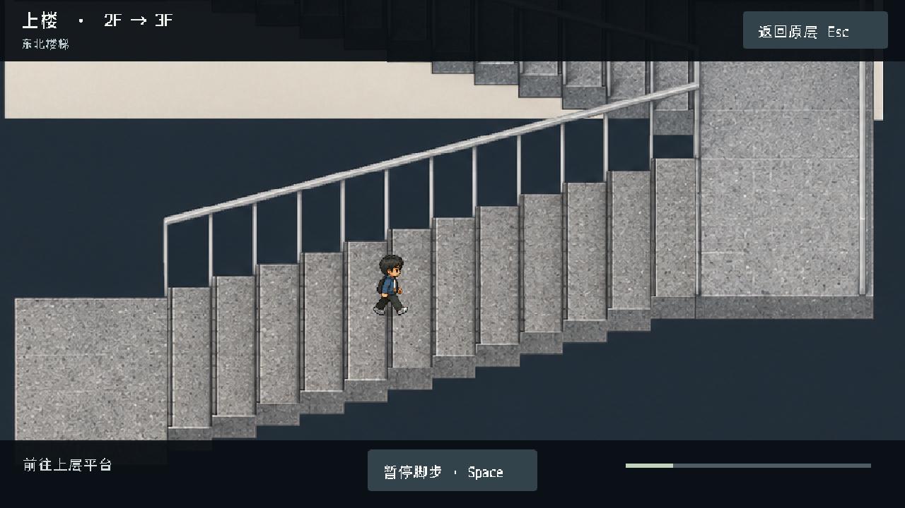
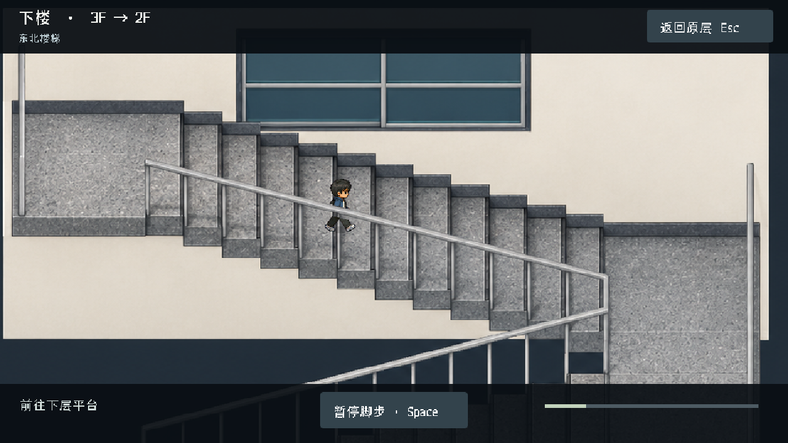
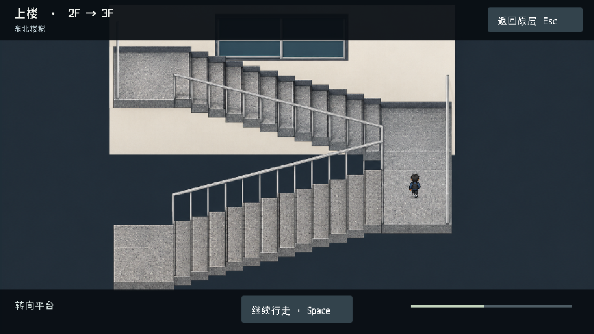

# 实拍细化与上下楼视角

本轮针对用户提供的 20 张照片。按用户最后更正，蓝色构架和彩色圆凳属于 **2F 大厅**；木柜、深灰长桌和树盆属于 **3F 茶水休息区**。其余照片不凭相似装饰推断房间编号。

## 透视修正

首张楼梯候选把两段楼梯画成并排同向上升，墙面还有消失点，已弃用，未导入项目。先用 `tools/render_stair_geometry.gd` 构建正交、无水平旋转的折返几何，再用内置 imagegen 转绘。最后生成图为 1672×941，与几何草图尺寸和局部位置不同，因此 `data/stair_section.json` 重新按最终图标定踏步、平台、行走线与前景扶手，未直接套用草图坐标。

同一张图用于两个行进方向。上楼为下方左端 → 右侧平台 → 上方左端，下楼严格沿相同路线返回；不翻转建筑、不使用透视拉伸。镜头以固定倍率向行进方向前看，人物尺寸复用共享脚底与精灵指标，后侧梯段以同源扶手像素遮挡人物。

两处既有楼梯均接入此局部行走视图，2↔3、3↔4 的楼层连接和源图楼梯位置不变。只有站在楼梯口才可进入；到达后复核源层与配对落点，再切换楼层。重复点击、取消、失焦不会提前换层。失焦暂停，显式继续后再走。这是独立建筑评审中的通行过程，未接入正式章节或存档。

梯段级数与尺寸仍是评审模型，照片不构成测绘数据。上楼、下楼与整体结构的截图来自实际 Godot 场景。

## 照片证据与采用范围

| 图片 | 可确认内容 | 本轮采用 / 约束 |
|---|---|---|
| 1 · 4641eb60… | 木柜、深灰共享长桌、树盆、混合座椅 | 继续采用已确认的 3F 茶水区；不改成白柜 |
| 2 · 593fd97a… | 蓝色构架、彩色圆凳、灰色大厅 | 保持用户更正的 2F 归属 |
| 3 · e7e20f7f… | 多层中空、玻璃栏杆、白色楼板边 | 作为垂直层次与栏杆参考 |
| 4 · f6eb5838… | 对向回廊、中心标志墙 | 不将跨层视线当成同层通路 |
| 5 · e3842808… | 移动高桌、白色椭圆展示桌、小型展品 | 记录家具类型，暂不虚构所在房间 |
| 6 · 7b38516b… | 蓝白文化墙、成排盆栽 | 记录材质与装饰，不推定精确位置 |
| 7 · 06f8ef60… | 白框期刊封面墙 | 作为墙面展示参考，不摆到地面 |
| 8 · 0c00fca3… | 明确 2F 标识、电梯门、两块展架 | 2F 电梯外观证据，门后仍非可行走地面 |
| 9 · e871c3cb… | 浅灰细颗粒地面、黑黄架、抽屉、仪器 | 灰地保留；零件架单独重建 |
| 10 · 5898547f… | 蓝架下方、曲面屏、双椅操作台 | 记录 2F 大厅设备，不擅改现有操作台玩法 |
| 11 · 838208be… | 黑黄透明抽屉架、白色带轮折叠桌 | 新增独立透明像素物件并用于机电区 |
| 12 · 2bb7d7a5… | 工具箱、抽屉、玻璃照片、设备介绍 | 用于工具架细节；具体 CNC 等设备不凭展板补放 |
| 13 · e65f3c12… | 带灯栽培架、盆栽、农业机器人 | 已记录，所在房间和楼层待确认后再放入 |
| 14 · a2e2b03b… | 白色茶水柜、蓝灰墙砖、水槽 | 与图 1 木柜分开记录，不混为一个茶水区 |
| 15 · 15a8054d… | 厚墙门洞、大厅地面和凳子 | 门洞深度与走廊视线参考 |
| 16 · 82bf38ef… | 向上梯段、灰石、浅灰扶手、窗 | 楼梯材质和上楼朝向主要参考 |
| 17 · a7212580… | 窄回廊、浅灰亮面地砖、灰框玻璃栏杆 | 不把所有空间改成同一种无缝地坪 |
| 18 · 84608157… | 半平台、窗和栏杆 | 折返点及高低关系参考 |
| 19 · acc55881… | 俯看下行梯段、平台、中央扶手 | 下楼朝向与遮挡主要参考 |
| 20 · 91d5754a… | 对坐白色工位、灰隔板、白黑储物柜 | 新建白桌和储物柜外观；具体柜数与楼层不视为照片已证实 |

## 物件与文件

三种家具均由内置 imagegen 生成，保留原始 RGBA 文件，未用程序抠图或变形。完整提示词与哈希记录在 `data/generation_20261028.json`，透明边界记录在 `data/object_assets.json`：

- `parts_rack_photo_v2.png`：黑色立柱、黄色横梁、透明抽屉、底部工具箱。
- `worktable_white_photo.png`：白色台面、灰色折叠架、脚轮与挡板。
- `locker_photo_v2.png`：白色柜门、黑框、青色读卡屏。

`apply_photo_details.mjs` 保留对象 ID、实心脚印与贴墙布局，按统一比例替换图像，并将桌面附属物移到新台面高度。家具摆位、数量仍属于评审布局，不声称现场逐件测绘完成。用户实拍原图不复制进仓库。

## 验证

见本轮 `PHOTO_DETAIL_VALIDATION.json`。其中包含原生空间、楼梯往返、取消与失焦、操作台回归及不同视口的记录。独立 Web 导出使用同一 Godot 场景；浏览器端真实输入验收另行标记，不能用导出成功代替。
