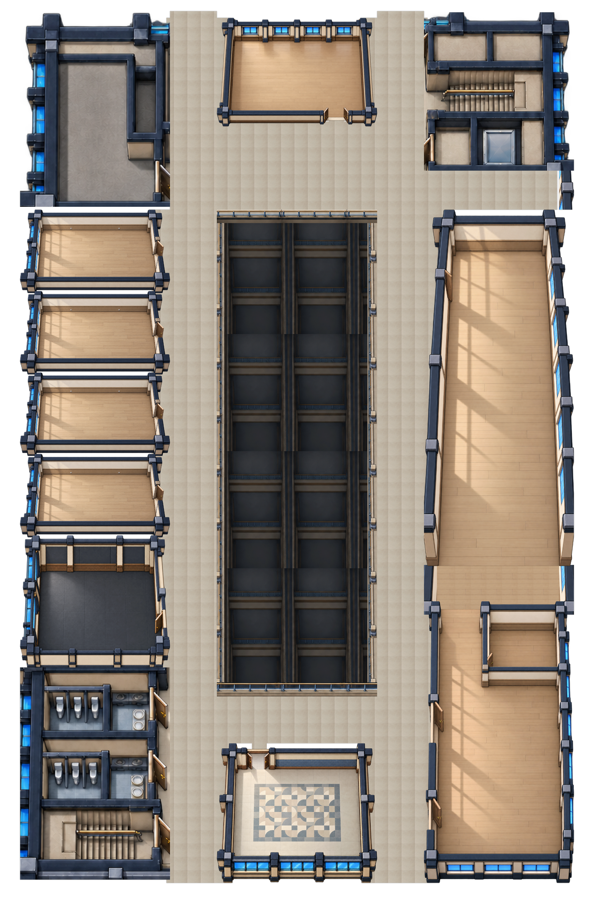
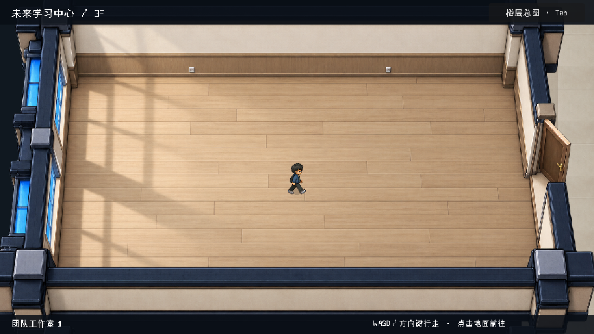

# Three-floor object review · 2026-10-28

Current working tree is based on `533ed6b7e874efa87b97613987434b1861868671` (merged PR #187). Engine: Godot 4.7.1.stable.official.a13da4feb. Latest local evidence directories are `flc_objects_final_desktop` and `flc_objects_final_mobile`; the review builder consumes those captures. This is source-tree validation, not a production release verdict.

| Floor | Rounded game-pixel dimensions | Independent render objects | Room apertures | Paired landings |
|---|---:|---:|---:|---:|
| 2F | 5659 × 8260 | 136 | 9 | 3 |
| 3F | 5325 × 8093 | 249 | 10 | 3 |
| 4F | 5325 × 8398 | 175 | 7 | 3 |

- Focused native geometry, objects, transit, camera and lighting suite: **1341 checks, 0 failures**.
- Native desktop 1280 × 720: **5 input checks, 0 failures**, zero illegal-foot frames.
- Native scaled 390 × 844: **5 input checks, 0 failures**, zero illegal-foot frames. Simulated touch, not a physical mobile device.
- Browser mechanic model: **13 behavioral checks passed**, covering both light solutions, repeated scoring, camera obstruction, furniture blocking, fast-drag collision and recovery around the camera.
- Seven added original PNGs were checked for real alpha, nonempty silhouettes and hashes before import: `monitor_front`, `desk_divider`, `tool_cart`, `parts_rack`, `coffee_machine`, `potted_plant`, `soldering_station`.
- Actual native studio, laboratory and pantry captures were visually inspected. The local review shows these captures, keeps a studio comparison, and labels the platform staging as a proposal.
- Native source/media sync and targeted validation passed prepared inputs, isolated saves, asset import/editor parse, startup, all-script parse and `test_future_learning_center_rooms.gd`. The tool reports partial validation because this is a focused profile, not a full release suite.
- The updated browser prototype was exercised through its real controls: east-side success, blocked cross-camera movement, a clear detour and west-side success. Gallery switching worked and the browser reported no warnings or errors.

The studio layout and object silhouettes are improved, but overall room/actor proportions and exact equipment placement remain under review. Existing panoramic atrium/closed mechanical-core crops remain in use. Window strips are provisional source-space placements. No final whole-building art acceptance, production NPC route, production save integration or full Web release is claimed. The browser prototype only implements the first 2F mechanic; later floor tasks remain a proposal.

## Historical empty 3F checkpoint

The material below records the earlier empty-room pass and is not the current furnishing verdict.

[Actual Godot doorway/camera walkthrough, 14 seconds](room_camera_walkthrough.mp4)

Generated from `data/floor_3.json` by the native review runner, Godot 4.7.1.stable.official.a13da4feb. The full-size PNG is 5325 × 8096; the embedded floor image is a uniformly reduced review copy. The video uses the actual room view, shared player frames, foot-space route and camera code. Its movement is scripted for capture; separate ordinary keyboard and scaled-touch checks were run.

Validation on the working tree based on `80ad46aa4b52bc1076f7d7c675f9e710a1207036`:

- Six room master PNGs: dimensions, true alpha, SHA-256 and outer-wall contour metadata verified.
- 132 focused geometry, room adjacency, doorway, route, complete-footprint and camera checks passed.
- Desktop 1280 × 720: five real engine-input checks passed; no illegal-foot frames.
- Scaled 390 × 844 window: five keyboard/touch checks passed; no illegal-foot frames. The game viewport remains 16:9. This is not a physical-device claim.
- Native source/media sync completed; staged native validation passed prepared inputs, isolated saves, editor asset import/parse, startup, all-script parse and the new room test entrypoint. This is a targeted run, not full release acceptance.

The current result is an empty 3F architectural review with room-focused framing. Transit cores and restroom detail still come from the earlier overview; 2F/4F individual rooms and paired inter-floor transit are not yet delivered. Props and NPCs are intentionally separate future layers. No production story/save/controller was changed.
