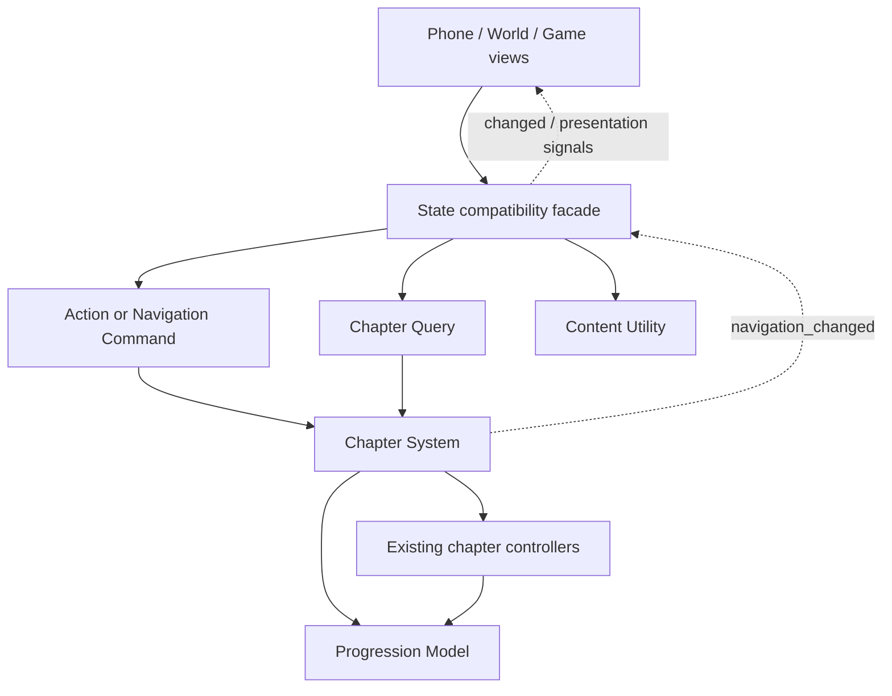

# QFramework architecture migration

Started 2026-11-01 at the user's request, based on game commit `72fe2ed3`.
This is the first integrated migration increment. Existing chapters and save
validation still define gameplay behavior. The remaining migration is explicit below.

## Dependency and engine

The actual official Godot implementation is vendored under `addons/qframework/`:

- Repository: https://github.com/liangxiegame/QFramework
- Exact revision: `965630644db2b9cb2c4523a0bfe6952fc01f770c`
- Source folder: `QFramework.Godot4.5+/addons/qframework/framework/architecture/`
- Six runtime scripts, unmodified, with the original MIT license.
- `UPSTREAM.json` records the source revision and SHA-256 for each included file.
- Editor plugins, upstream examples, GUT and optional toolkits are not runtime dependencies.

The project engine pin remains Godot 4.7.1. Full local validation passed with
Godot 4.7.2 `ed1daf0bf`, and focused core compatibility validation passed with
cached Godot 4.7.1 `a13da4feb`. The user accepted using the local patch version
for this work. A fresh Web export and browser acceptance remain outstanding.
The upstream MIT notice is also reproduced in the native root `NOTICE`, which
is already included by all production export presets.

## Runtime composition

`State` creates one `GameArchitecture` node. The official `Architecture` lifecycle
mounts its registered components under `Utility`, `Model` and `System` and initializes
them in that order.

| QFramework role | Current implementation | Responsibility |
| --- | --- | --- |
| Architecture | `scripts/architecture/game_architecture.gd` | Register the game's components and dispatch synchronous operations |
| Model | `models/progression_model.gd` | Own the single native progression dictionary and provide detached read snapshots |
| System | `systems/chapter_system.gd` | Dispatch authored chapter intents, apply story input locks, query chapter presentation data, own shared navigation mutations |
| Command | `commands/story_action_command.gd` | Carry one action and its input to the chapter system |
| Command | `commands/navigation_command.gd` | Carry page/scene/mode/item-selection intent to the chapter system |
| Query | `queries/chapter_query.gd` | Return pages, page content, action lists, targets, objective or detached snapshot |
| Utility | `utilities/content_utility.gd` | Load/cache bundled source JSON and compressed developer checkpoint data |
| Compatibility facade | `scripts/state.gd` | Retain existing callers, result acceptance, presentation signals, save/import validation and runtime session bridges during migration |



`State.d` forwards to `Progression.snapshot`; `State.modules` forwards to
`Chapters.modules`. They are compatibility properties, not copied state. Existing
save loads, imports, new games, preview restoration and direct dictionary replacement
immediately reach the same model. There is no extra autoload, second save or schema change.

`State.act()` sends a `StoryActionCommand`. The system preserves chapter dispatch
order, narrative locks, the pre-action snapshot and the first handled result.
The facade then applies the existing `_accept_result()` behavior: including ephemeral
session handling, save order, feedback/media intents and `action_completed`.

`open_page`, `open_scene`, `toggle_mode` and `select_item` send navigation commands.
The system emits `navigation_changed(persist)`; the compatibility facade saves when
required and emits `changed`. Invalid selection and story locks retain their former
behavior. View nodes are not passed down to the new navigation system.

## Synchronous adapter

Official `Architecture.send_command/send_query` use `await`. The project subclass
overrides both methods synchronously to preserve existing return values, transactional
save ordering and signal timing. Both operations clear their temporary architecture
reference after execution. A command/query contains only invocation input, with no
retained progression, session or execution result.

Do not introduce `await` into these project commands or queries. An asynchronous
operation needs a deliberately separate API and lifecycle tests. Vendor files stay
unchanged; this adaptation belongs to `GameArchitecture`.

Godot must see the concrete `GameArchitecture` return type at the facade call site;
using the upstream `Architecture` static type makes GDScript require `await` even
when the project override is synchronous.

## Rules for further migration

- Views submit mutations through commands and read through queries or detached snapshots.
- Systems may depend on systems, models and utilities; models may depend on utilities.
- Lower layers report changes through signals/events and never obtain a view or call the facade.
- Preserve the domain controllers' evidence gates, item transactions, session capabilities,
  movement semantics, source coordinates, import validation and recovery behavior.
- Keep runtime-only animation and input timing out of persistent progression.
- Avoid speculative networking work: QFramework is the selected architecture library;
  this increment does not introduce a multiplayer authority or protocol.

## Remaining migration

1. Split the compatibility facade's `_accept_result` into an application system and
   validated save utility, preserving synchronous events and transaction behavior.
2. Move explicit session operations (lake world ticks/strokes, progressive cancellation,
   home charging and phone advancement) behind typed commands and queries. Their current
   bridges still use the existing chapter controller contracts.
3. Audit direct `State.d` mutations in existing views, replace them with domain commands
   and migrate each view's reads to snapshots/queries. The writable compatibility property
   remains necessary during this increment and is not a claim of full layer enforcement.
4. Move the independent future-learning-center room checkpoint commit/restore facade into
   a dedicated system with the existing namespace validator and rollback guarantees.
5. Gradually separate chapter models/systems where that reduces coupling. Do not mechanically
   rename every existing controller or replace verified domain algorithms.
6. Retained React/Phaser source is still a behavioral oracle. It has not been converted into
   a second QFramework runtime; Godot remains the active application runtime.

The four-floor architectural viewer is a separate authoring artifact. Its floor plans,
photo references and object assets remain the continuation baseline for the visual task;
this game runtime migration does not modify that viewer.

## Verification

The new `test_qframework_architecture.gd` exercises the real facade and the official
component lifecycle, checks dictionary replacement, detached reads, ordinary synchronous
actions, navigation events, and compares command results/state against the original
chapter controllers across all 117 developer checkpoints. It also checks that presentation
queries do not change progression. The existing continuous campaign and actual-file save
integration suites remain the broad behavior checks.

`verify_qframework_provenance.mjs` is registered in the native validation catalog.
The GDScript test is discovered by the existing `test_*.gd` catalog. Use the native
sandbox runner so tests cannot write the player's formal save:

```sh
node godot_native/tools/sync_source.mjs
bash godot_native/tools/convert_media.sh
GODOT_BIN=/path/to/godot node godot_native/tools/validate_native.mjs --profile changed \
  --test test_qframework_architecture.gd --test qframework_provenance \
  --test test_native_state.gd --test test_save_integration.gd \
  --test test_full_campaign.gd --test test_phone_entry_lifecycle.gd \
  --test test_flc_save_integration.gd
```

Focused validation is not a full native suite, manual playthrough, browser delivery or
physical-device acceptance. Reports retain the tested base revision and exact-content
identity; keep these distinctions when reporting progress.

## Validation record (2026-11-01)

The tested runtime commit is `08d99c15daa4eb17546c4f3859593d7b42624434`.
The subsequent documentation/NOTICE commit does not change runtime code.
Both native runner reports record `inputChangedDuringRun: false`.

| Check | Result |
| --- | --- |
| Full native suite, Godot 4.7.2 | 604 registered entries covered: 603 passed, 1 audited duplicate, 0 failures or blocked entries |
| Focused core suite, Godot 4.7.1 | 11 selected entries passed, 0 failures; this is not a second full-suite run |
| QFramework behavior comparison, both engines | 1,065 checks, 234 action comparisons across 117 checkpoints, 0 failures |
| Actual-file save integration, both engines | 1,829 checks, 236 real-file browser-save imports, 0 failures |
| Continuous native campaign, Godot 4.7.2 | Chapters 1, 2, 3 and 4 completed, 0 failures; automated, not a manual playthrough |
| Native validation runner/registration Node contracts | 36 passed |
| Vendor source integrity | All 6 scripts and the license match the pinned upstream Git tree blobs |

The full runner audited `test_buct_rongmao.gd` as identical to an existing
registered execution: same script bytes, scene, environment and inputs, with
no self-path introspection. No regression file was removed.

Raw reports and logs are retained in the chat artifact folder
`qframework_architecture_20261101/`, alongside `validation_summary.json`.
