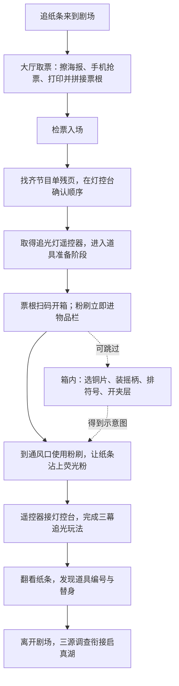

# 剧场玩法与箱子衔接 · 审阅稿

2026-10-23 审阅时快照。下文“当前”指改动前版本，保留作方案依据。用户确认执行后，连续箱内主线已接入原生控制器；现行行为与验证见 [实施记录](THEATER_CHEST_STORY_20261023.md)。

**整段剧场的目标应始终清楚：追上纸条 → 用舞台设备让它显形 → 抓到后发现是替身 → 沿新线索离开。**

## 当前实际流程

箱内当前能做的是：翻纸条看符号顺序 → 点选铜片再点凹槽装入 → 点选摇柄再点中轴安装 → 点击中轴旋转 → 符号正确后点夹层把手。铜片能换位，物件有厚度、遮挡和装配动画；目前不是自由拖拽或物理翻找。

## 当前衔接的问题

1. **解谜缺少必要回报。** 扫码已发粉刷，玩家不解箱内机关也能完成通风口主线。夹层图没有保存为证据或承接任务状态。
2. **摇柄安装有要求，转动没有真正的作用门槛。** 直接把三片摆成正确顺序，再安装摇柄，就能开夹层；无需实际转过一次。不能把演示里转过一次说成游戏必需步骤。
3. **重复了前一段的排序玩法。** 节目单刚排过一次顺序，箱内又照纸条排三个符号，推理内容偏薄。
4. **关闭就复位。** 离开再回来会丢失装配进度，完成夹层也没有持续结果。源文案仍有“箱子空了，荧光粉刷已经收好”，与现有有物件画面不一致。

## 建议的连续玩法

| 环节 | 玩家操作 | 看得见的反馈与下一步理由 |
| --- | --- | --- |
| 明确目的 | 看见舞台上的纸条躲开光；从现有残影提示得知箱内有粉刷 | 目标是取得能标记纸条的工具，先知道为什么要开箱 |
| 开箱 | 用保留下来的票根刷读票器 | 锁舌松开、盖子抬起，镜头沿原箱子推进到垂直俯视；此时只解锁外箱 |
| 翻找 | 移开叠放铜片，露出压住的纸条与零件 | 上层物件挪走后，下层内容才显露；杂乱与堆叠参与玩法 |
| 复原机关 | 根据零件缺口与磨损位置装回铜片和摇柄，再校准轮盘刻线 | 重点从再次排序变成观察和装配；正确后转柄实际带动锁舌，夹层才释放 |
| 获得成果 | 拉开夹层，亲手取出荧光粉刷，并查看通风口图 | 粉刷入侧边物品栏；图上的格栅形状对应场景中的真实通风口 |
| 回到场景 | 镜头退出，保留人物位置；玩家走向通风口并使用粉刷 | 粉末被气流带上舞台，纸条留下荧光痕迹，再自然引向灯控台和三幕追光 |

装配和夹层状态应保存；退出后再开箱沿用上次状态，取走的物品不再出现。失败只给出对应反馈，例如摇柄未装、锁舌未对齐，不清空已做操作。

**建议版本涉及把原有粉刷的发放时机，从扫码改到夹层取出，并使箱内机关成为道具准备的一环。** 这是主线规则变化，需要作为后续明确改动处理；本次只展示方案，没有移动奖励、改变消耗或新增关卡门槛。

## 画面如何接住信息

- 开箱：世界里的箱子、抬盖和箱底近景连续，始终能认出是同一个对象。
- 翻找：只突出被选中的物件；抬起、投影变化和下层显露说明操作结果。
- 解开：以锁舌回缩、夹层移动和工具露出表达成功，不插入独立成功弹窗。
- 返回：镜头还原到剧场；风声与纸屑运动提示通风口。玩家仍亲自走过去操作。

## 核对依据

- `scripts/chapters/chapter3.gd`：节目单解锁、扫码发粉刷、通风口消耗、三幕追光、替身与离场。
- `scripts/games/theater_chest_mechanism.gd`：临时会话、符号排列、摇柄、夹层；当前打开判定不要求 `turns > 0`。
- `scripts/ui/theater_chest_closeup.gd`：点选后装槽、镜头、退出和动画。
- `../src/data/chapter3-theater.content.json`：剧场原目标与对话。

本次是玩法审阅，没有重新运行全章或改变实现。上一轮原生实测与限制见 `THEATER_CHEST_MECHANISM_ACCEPTANCE_20261023.json`。
